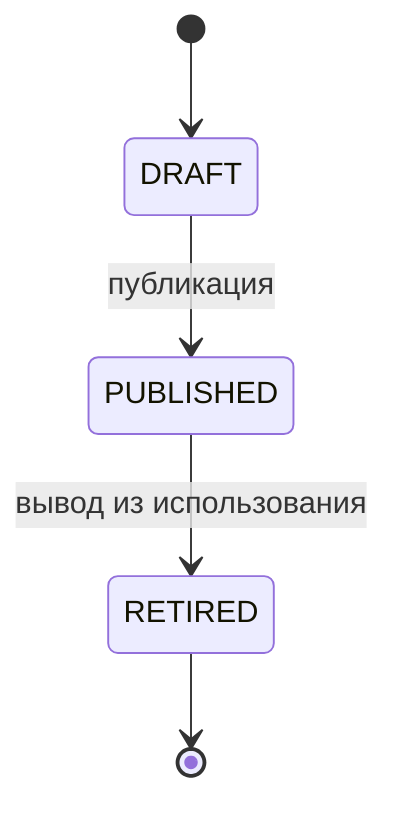
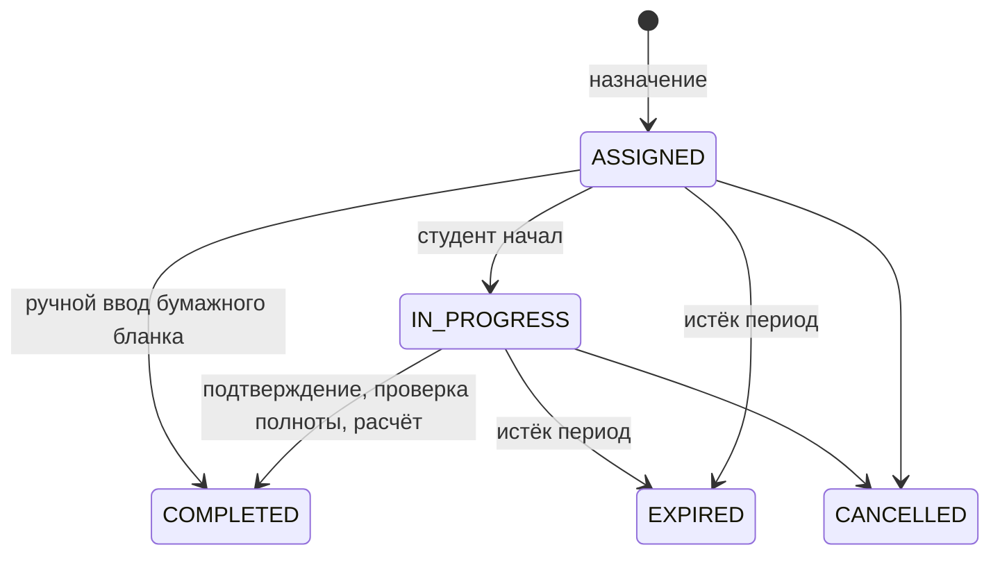
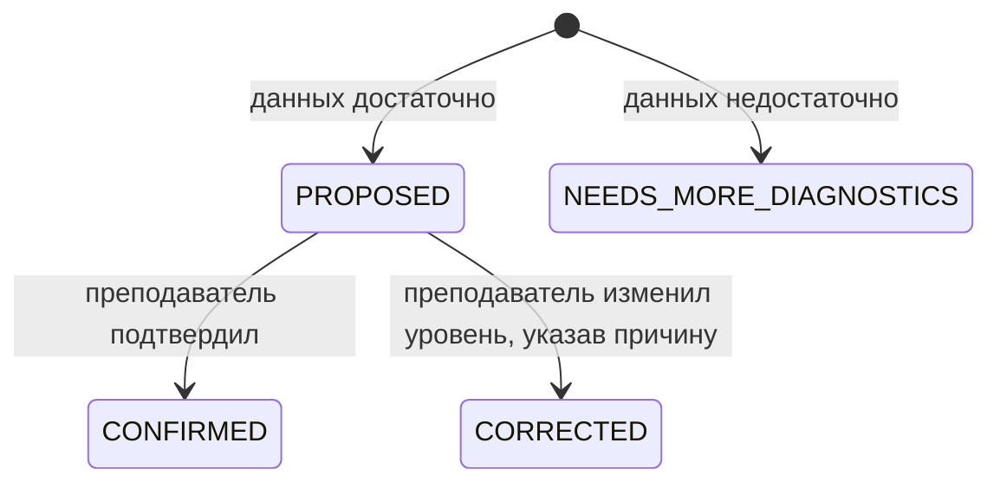
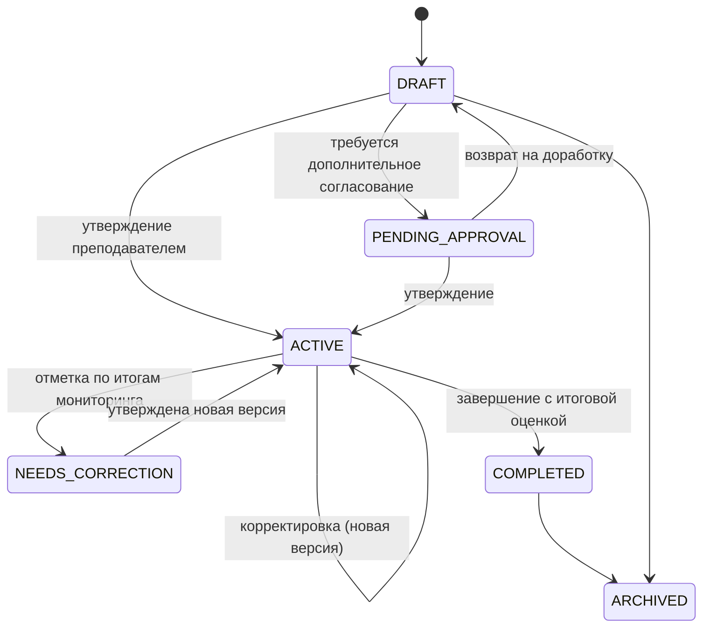
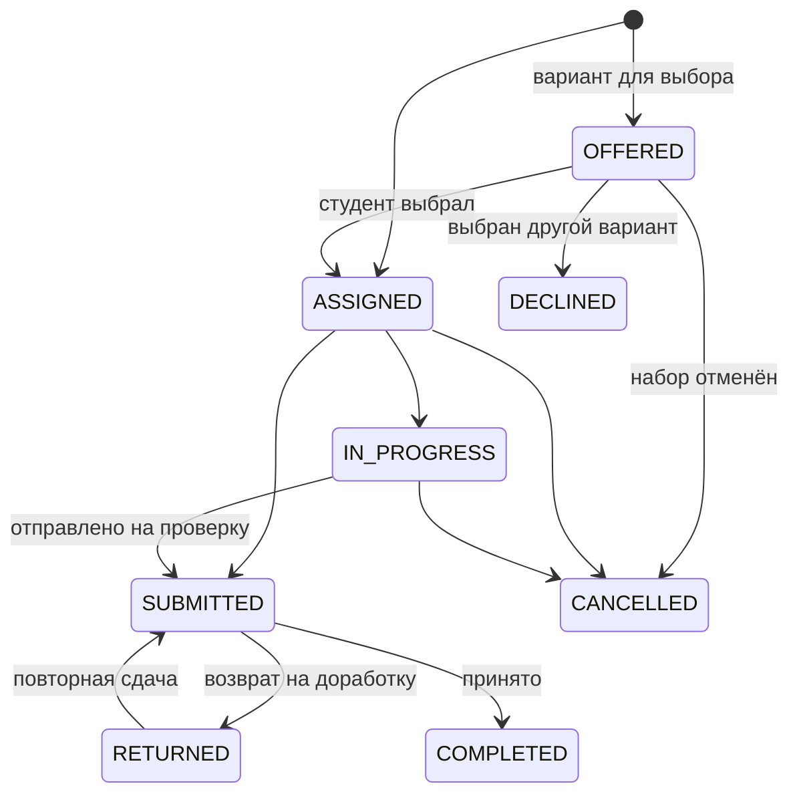

# Модель данных

Документ описывает схему базы данных PostgreSQL: соглашения, назначение групп таблиц, жизненные циклы статусов, правила неизменяемости и версионирования. Источник истины — `apps/api/prisma/schema.prisma`; диаграммы связей — [er-diagram.md](er-diagram.md) (генерируется командой `pnpm db:erd`).

## 1. Соглашения

- **Имена.** Таблицы и столбцы — `snake_case`. Модели Prisma — `PascalCase`, поля — `camelCase`, соответствие задаётся через `@@map` / `@map`. Все 28 таблиц из п. 7 ТЗ существуют под своими именами; остальные таблицы — вспомогательные (NFR-009).
- **Идентификаторы.** `uuid` версии 7 (`@default(uuid(7))`): упорядочены по времени создания и не раскрывают количество записей. Исключение — `system_settings` (ключ — строка).
- **Служебные поля.** `created_at`, `updated_at` (где запись изменяется), `created_by` (кто создал). Поля «кто» (`created_by`, `decided_by`, `approved_by` и т. п.) хранят идентификатор пользователя; внешний ключ заведён там, где связь нужна для запросов.
- **Удаление.** Предметные записи физически не удаляются. Для справочников и профилей используется архивирование (`archived_at`), для пользователей — статус `ARCHIVED`. Внешние ключи по умолчанию `ON DELETE RESTRICT`, чтобы случайное удаление не уничтожило историю. Каскадное удаление разрешено только для составных частей ещё не опубликованных объектов (вопросы и шкалы черновика методики, этапы шаблона) и для служебных связей.
- **Отсутствующие данные.** Пропуск хранится как `NULL`, а не как ноль (FR-074): например, `diagnostic_scores.raw_score`, `reflections.self_assessment`.
- **Перечисления.** Статусы и типы — enum PostgreSQL. Их значения продублированы в `packages/shared/src/enums.ts` вместе с русскими подписями; совпадение проверяет тест `apps/api/src/prisma/enums.spec.ts`.
- **Даты.** Моменты времени — `timestamp(3)`; плановые даты без времени (сроки этапов, контрольные точки, период исследования) — `date`.

## 2. Группы таблиц

### 2.1. Пользователи, роли, права

`users` — учётные записи всех ролей. `roles`, `permissions`, `role_permissions` — роли (`admin`, `teacher`, `student`, `researcher`) и гранулярные разрешения. `user_roles` — роли пользователя. `user_permissions` — разрешения, выданные конкретному пользователю сверх роли, с обязательным основанием и необязательным сроком действия: так оформляется доступ к содержанию диагностических ответов (п. 2.1) и доступ исследователя к персональным данным (п. 2.4). `auth_sessions` — refresh-сессии; хранится только хеш токена.

Поля `failed_login_attempts` и `locked_until` поддерживают ограничение попыток входа (п. 8.3).

### 2.2. Группы, дисциплины, студенты

`groups`, `disciplines` — справочники. `teacher_assignments` — закрепление преподавателя за парой «группа — дисциплина» с периодом действия; это основа политики доступа к данным (FR-002): преподаватель видит студентов только тех групп и дисциплин, за которыми закреплён.

`students` — профиль студента. Учётная запись (`user_id`) может отсутствовать, например до активации. `participant_code` — постоянный код участника для обезличенного отображения. `current_group_id` — текущая группа (денормализация для фильтров и поиска); полная история принадлежности к группам хранится в `enrollments`. Перевод в другую группу (FR-010) в одной транзакции закрывает текущую запись `enrollments` (`ends_at`), открывает новую и меняет `current_group_id`. Архивирование (FR-011) заполняет `archived_at` и `archive_reason`, данные остаются.

`pedagogical_observations` — наблюдения с датой и автором (FR-014); по умолчанию видимость `INTERNAL` (FR-016).

`lessons` — занятия по расписанию (этап 25): группа, дисциплина, преподаватель, дата (`DATE`) и время начала строкой «ЧЧ:ММ»; уникальны по группе, дисциплине, дате и времени. `observation_criteria` — критерии наблюдения на занятии (список ведётся в «Настройках»; критерий не удаляется, а архивируется). `lesson_journal_entries` — строка журнала по студенту на занятии с отметкой «Отсутствовал»; `lesson_ratings` — оценка по критерию: 1–5 или `NULL` («Не наблюдалось»), ограничение `CHECK`. Нет строки оценки — «нет данных», не ноль (FR-074). Журнал — служебные данные, студенту не передаётся (FR-016). Подробнее — ADR-031.

### 2.3. Диагностика

Методика (`questionnaires`) — постоянная сущность с направлением, статусом и признаком демо-методики. Всё содержание и правила обработки находятся в версии (`questionnaire_versions`): поля п. 4.4, вопросы (`questions`), варианты ответов (`answer_options`), шкалы (`questionnaire_scales`), ключи (`scoring_keys`), правила интерпретации (`interpretation_rules`). Направления (`diagnostic_directions`) настраиваемые.

`scoring_keys` описывает вклад вопроса в шкалу: для вопросов с выбором — баллы за конкретный вариант (`answer_option_id` + `points`), для шкалы Лайкерта и числовых ответов — значение ответа с весом и, при необходимости, обратным кодированием (`is_reverse`, по границам `questions.min_value`/`max_value`). Один вопрос может входить в несколько шкал (FR-021). Правило интерпретации сопоставляет диапазон баллов шкалы уровню, тексту для преподавателя и понятному тексту для студента (FR-016); поле `motivation_level` указывает вклад уровня в мотивационный профиль. Порядок ключей внутри шкалы хранится в `scoring_keys.sort_order` (на расчёт не влияет). Алгоритм расчёта и обработка пропусков — ADR-012.

`questionnaire_scales.aggregation` (этап 23) — способ расчёта балла шкалы: `SUM` — сумма вкладов ключей, `MEAN` — сумма, делённая на число вопросов шкалы, с округлением до 0,1 (методика Реана — Якунина в модификации Бадмаевой). Миграция `20261023120000_scale_aggregation` задала существующим шкалам `SUM`, поэтому сохранённые баллы не изменились. Поле защищено теми же триггерами неизменяемости, что и остальное содержимое опубликованной версии; версии с разным способом расчёта одной шкалы нельзя объявить сопоставимыми.

`questionnaire_scales.motivation_role` (этап 24) — роль шкалы в мотивационном профиле: `INTRINSIC` (внутренняя мотивация — определяет уровень методики), `EXTRINSIC` (внешняя — только предупреждение о её преобладании), `REFERENCE` (справочная). Миграция `20261023140000_scale_motivation_role` задала существующим шкалам `REFERENCE`: их версии формируют профиль прежним правилом (голосование шкал по `interpretation_rules.motivation_level`). Поле защищено триггерами неизменяемости опубликованной версии. В `motivation_profiles.basis` профили нового правила хранят `rule: "METHODOLOGIES"`, уровни методик (`methodologies`) и итог сведения (`outcome`, `explanation`); профили, сформированные раньше, хранят прежнюю структуру и не пересчитываются.

`questionnaire_version_comparabilities` — утверждённая исследователем сопоставимость двух версий (UC-06): только по таким парам допускается сравнение повторных замеров. С этапа 08 пара хранится упорядоченной: `version_a_id` — более ранняя версия, поэтому уникальное ограничение отсекает повторное утверждение в любом порядке; отзыв удаляет строку с записью причины в аудит (ADR-014). Тип замера (`measurement_type`) задаётся в назначении и копируется в каждое прохождение.

`diagnostic_assignments` — назначение версии методики студенту или группе на период (FR-018, FR-019), с типом замера и, при наличии, привязкой к замеру исследования. `diagnostic_sessions` — прохождение одним студентом: статус, источник (`ONLINE`/`PAPER`, FR-022), черновик ответов, время начала, завершения и длительность (FR-023). Пара «назначение — студент» уникальна, поэтому повторное создание сессии не порождает дублей (NFR-006).

Результаты сессии организованы по ревизиям (`diagnostic_revisions`): ревизия 1 (`INITIAL`) создаётся при завершении; исправление ошибочного ввода (`CORRECTION`, FR-013) и пересчёт по новой версии ключей (`RECALCULATION`, FR-026) создают следующую ревизию с причиной и автором. `diagnostic_answers` и `diagnostic_scores` хранят номер ревизии; действующая ревизия указана в `diagnostic_sessions.current_revision`.

### 2.4. Мотивационные профили

`motivation_profiles` — запись профилирования: предложенный уровень (`proposed_level`, `NULL` при недостатке данных), итоговый уровень после решения преподавателя (`level`), показатели-основания (`basis`, FR-028), причина корректировки (FR-029), понятная студенту интерпретация. `motivation_profile_sources` связывает профиль с диагностическими сессиями-основаниями. `motivation_profile_history` — неизменяемый журнал изменений статуса и уровня (FR-032). Тексты стратегий для трёх уровней (FR-030) хранятся в `system_settings` и редактируются в настройках.

### 2.5. Файлы и материалы

`files` — метаданные загруженных файлов: случайное имя в хранилище (`storage_key`), исходное имя, MIME-тип по содержимому, размер, контрольная сумма. Содержимое выдаётся только через API с проверкой прав. `materials` — библиотека материалов (файл, ссылка или текст) с дисциплиной и темой.

Реализация этапа 10 (ADR-016): содержимое файлов хранится в каталоге `FILE_STORAGE_DIR` (по умолчанию `storage/<NODE_ENV>` в корне репозитория) под именем-UUID без расширения. У материала заполнено ровно одно поле содержимого по виду: `file_id` для «Файл», `url` для «Ссылка», `body` для «Текст» — сервер очищает остальные. `discipline_id = NULL` означает общий материал, видимый всем преподавателям. Материалы и задания не удаляются, а архивируются (`archived_at`), поэтому ссылки из ИОТ и назначенных заданий остаются действительными.

### 2.6. Траектории (ИОТ)

`trajectory_templates` и `trajectory_template_stages` — шаблоны маршрута, в том числе стандартный пятиэтапный и варианты под мотивационные профили (FR-034, FR-035).

`trajectories` — паспорт ИОТ (п. 4.6): студент, дисциплина, преподаватель, профиль на момент назначения, цели, планируемые результаты, сроки, текущий этап, статус, номер версии. Ограничений на количество ИОТ у студента нет (FR-045). `trajectory_stages` — этапы маршрута с плановыми сроками и статусом, `trajectory_checkpoints` — контрольные точки этапов, `stage_materials` — материалы этапа (FR-037).

`research_project_id` отмечает участие маршрута в исследовании; запрет ИОТ для контрольной группы (огр. 4) проверяется на сервере по `research_participants.group`.

Реализация этапа 11 (ADR-017): системные шаблоны создаются без автора (`created_by = NULL`) — стандартный (`is_standard`) и по одному на уровень профиля (`motivation_level`). У студента может быть несколько ИОТ по разным дисциплинам, но по одной дисциплине — не более одной действующей (статусы «Черновик», «На утверждении», «Активна», «Требует корректировки»); правило проверяет сервер. Задания этапа хранятся в `trajectory_assignments` с `trajectory_id` и `stage_id`: в черновике это план, при утверждении `assigned_at` и `assigned_by` фиксируют момент назначения. `trajectories.motivation_profile_id` в черновике указывает на утверждённый профиль на момент создания и обновляется при утверждении. Снимок версии `trajectory_versions.snapshot` имеет форму `TrajectorySnapshot` из `packages/shared/src/trajectories.ts`.

### 2.7. Задания

`assignments` — библиотека заданий (FR-046, FR-047) с типом из настраиваемого справочника `assignment_types`, уровнем сложности, допустимыми форматами сдачи, критериями (`assessment_criteria`) и вложениями (`assignment_attachments`, FR-049). Сложность задания не связана с мотивационным профилем на уровне схемы (FR-033).

Реализация этапа 10: стандартные типы п. 4.7 (`is_system = true`) API заносит в `assignment_types` при запуске по каталогу `SYSTEM_ASSIGNMENT_TYPES` (`packages/shared/src/library.ts`); пользовательские типы получают код `custom_<uuid>`. `assignments.max_score` — сумма максимальных баллов критериев (`NULL` без критериев), пересчитывается сервером при сохранении. При изменении задания критерии и вложения заменяются целиком; если по критериям уже выставлены баллы (`assessment_criterion_scores`), изменить критерии нельзя.

`trajectory_assignments` — назначение задания конкретному студенту (FR-048): при назначении группе создаётся запись на каждого студента. Привязка к ИОТ и этапу необязательна. `assignment_choice_groups` объединяет равнозначные задания, из которых студент выбирает нужное количество (FR-054). `submissions` — попытки сдачи с порядковым номером (FR-050, FR-051), `submission_files` — файлы попытки, `assessments` — проверка попытки (решение, балл, комментарий для студента), `assessment_criterion_scores` — баллы по критериям (FR-052).

### 2.8. Сопровождение и обратная связь

`feedback` — рекомендации, комментарии, краткосрочные цели и запросы самооценки преподавателя, вопросы, сообщения о затруднениях и предложения изменить маршрут от студента. Запись привязывается к студенту и, при необходимости, к ИОТ, этапу или заданию (FR-064); ответы образуют ветку через `parent_id` (FR-063). Поле `visibility` разделяет видимые студенту записи и внутренние заметки (FR-068).

`consultations` — консультации (FR-067): итог `summary` виден студенту, `internal_note` — нет. `reflections` — рефлексия и самооценка, в том числе после контрольной точки (FR-066). `academic_results` — учебные достижения: оценки за задания (одна запись на проверку) и результаты, внесённые вручную.

Учебная активность (задания, сдачи, `academic_results`) и диагностические показатели хранятся раздельно (FR-062); отсутствие входа в систему нигде не записывается как показатель мотивации.

### 2.9. Исследование

`research_projects` — исследования. `research_participants` — участник: студент, исследовательский код (уникален в пределах исследования) и группа `EXPERIMENTAL`/`CONTROL`. `research_measurements` — замеры исследования (первичный, повторный) по конкретной версии методики (FR-072); назначения диагностики ссылаются на замер.

### 2.10. Служебные таблицы

`audit_logs` — журнал значимых действий (п. 8.3): кто, что, над какой сущностью, состояние до и после, причина. ПДн в поля `before`/`after` записываются только в объёме, необходимом для аудита. `notifications` — внутрисистемные уведомления. `idempotency_keys` — ключи идемпотентности форм (NFR-006): пара «пользователь — ключ» уникальна, повторный запрос возвращает сохранённый ответ. `system_settings` — системные настройки «ключ — значение».

## 3. Жизненные циклы статусов

Переходы, описанные ниже, — целевые. Они реализуются и проверяются сервисами на этапах, указанных в скобках; схема БД хранит только текущее значение.

### 3.1. Версия методики (этап 06)

Черновик редактируется свободно. Опубликованная версия неизменяема: изменение вопросов, ключей, шкал или правил интерпретации создаёт новую версию-черновик (`version_number + 1`) — FR-026. Методика целиком архивируется статусом `ARCHIVED` (FR-017).

### 3.2. Диагностическая сессия (этап 07)

Незавершённые сессии (`ASSIGNED`, `IN_PROGRESS`, `EXPIRED`, `CANCELLED`) исключаются из аналитики и учитываются как пропуски (FR-073).

### 3.3. Мотивационный профиль (этап 09)

Профиль со статусом `NEEDS_MORE_DIAGNOSTICS` не имеет уровня. Каждый переход записывается в `motivation_profile_history`. Новое профилирование создаёт новую запись `motivation_profiles`, на неё указывает `students.current_motivation_profile_id` (текущий профиль для карточки и фильтров); действующим для проектирования ИОТ считается последний подтверждённый или скорректированный профиль студента.

### 3.4. ИОТ (этапы 11, 14)

Утверждает только преподаватель с соответствующим правом (FR-039). Набор переходов закреплён конечным автоматом `TRAJECTORY_TRANSITIONS` в `packages/shared/src/trajectories.ts` (этап 11); содержимое без новой версии редактируется только в черновике.

Реализация этапа 14 (ADR-020): «Активна» → «Требует корректировки» — отметка с причиной; корректировка из «Активна» и «Требует корректировки» создаёт версию `current_version + 1` со снимком и причиной в `trajectory_versions` и оставляет (или возвращает) статус «Активна» — прежние снимки неизменны. При корректировке убранный этап получает `archived_at`, убранное задание — статус «Отменено»; начатые и выполненные задания и отмеченные контрольные точки не убираются. Завершение «Активна» → «Завершена» записывает `completed_at` и `final_assessment` (итоговая оценка, видна студенту) и отменяет незавершённые задания; при ответах на проверке запрещено. «Завершена» → «Архивирована» — с причиной.

### 3.5. Этап и контрольная точка (этапы 11–14)

Этап: `NOT_STARTED` → `IN_PROGRESS` → `COMPLETED`. Контрольная точка: `PENDING` → `PASSED` или `MISSED` (пропущенная точка порождает предупреждение, FR-058).

Реализация этапа 13 (FR-042): первый этап становится `IN_PROGRESS` при утверждении ИОТ; дальше статус этапа пересчитывается по его действующим заданиям — начата работа над любым заданием → `IN_PROGRESS`, приняты все → `COMPLETED` (`completed_at`). Этап без заданий автоматически не меняется, назад статус не откатывается. Когда завершается текущий этап, `trajectories.current_stage_id` указывает на следующий незавершённый этап, который становится `IN_PROGRESS`. Версия ИОТ при этом не создаётся. Процент выполнения не хранится — считается по статусам заданий.

Реализация этапа 14: контрольную точку отмечает преподаватель (`PENDING`/`PASSED`/`MISSED`, при `PASSED` — `passed_at`); фоновая задача мониторинга переводит в `MISSED` точки действующих ИОТ, дата которых прошла. Этап без заданий завершается, когда пройдены все его контрольные точки. Текущим этапом всегда становится первый по порядку незавершённый действующий этап (`apps/api/src/trajectories/stage-progress.ts`). Статус сопровождения студента (`students.support_status`, FR-060) меняет преподаватель в мониторинге с основанием в журнале аудита.

### 3.6. Назначенное задание (этапы 12, 13)

Реализация этапа 12 (ADR-018): студент видит назначение, если оно действует (не `DECLINED` и не `CANCELLED`) и создано вне маршрута либо относится к ИОТ в статусе «Активна», «Требует корректировки» или «Завершена»; задания черновика ИОТ (`ASSIGNED` с этапа 11) скрыты до утверждения. Выбор из набора делается один раз: `assignment_choice_groups.chosen_at` заполняется условным обновлением, выбранные варианты — `ASSIGNED`, остальные — `DECLINED`. Отменить можно только не начатое (`OFFERED`, `ASSIGNED`) задание вне маршрута; невыбранный набор отменяется целиком. Предложения студента изменить маршрут (п. 2.3) хранятся в `feedback` с видом `ROUTE_CHANGE_PROPOSAL` и не меняют ИОТ.

Реализация этапа 13 (ADR-019): `ASSIGNED` → `IN_PROGRESS` — «Приступить к выполнению» (необязательно); `ASSIGNED`/`IN_PROGRESS`/`RETURNED` → `SUBMITTED` — новая запись `submissions` (номер попытки `attempt_number`, текст, ссылка, файлы в `submission_files`); `SUBMITTED` → `COMPLETED` (`completed_at`) или `RETURNED` — запись `assessments` по последней попытке (одна на попытку) с баллами по критериям в `assessment_criterion_scores`. Принятая оценка с баллом копируется в `academic_results` (источник `ASSIGNMENT`, балл и максимум — сумма по критериям). Переходы выполняются условным обновлением статуса, поэтому параллельные запросы не создают лишних попыток и проверок.

Просрочка не хранится как статус: задание просрочено, если `due_at` прошёл, а статус — `ASSIGNED`, `IN_PROGRESS` или `RETURNED` (ответ не отправлен). Так статус не расходится с текущей датой. Попытка, отправленная после срока, отмечается в интерфейсе по `submitted_at > due_at`.

### 3.7. Консультация (этап 15)

`REQUESTED` (запрос студента) → `SCHEDULED` (назначена) → `HELD` (проведена); из `REQUESTED` и `SCHEDULED` возможна отмена `CANCELLED`. Преподаватель может сразу назначить консультацию (`SCHEDULED`). Перенос назначенной консультации меняет `scheduled_at`, статус остаётся `SCHEDULED`. При проведении сохраняются `held_at`, итог для студента (`summary`) и внутренняя заметка (`internal_note`, студенту не выдаётся).

### 3.8. Сообщение обратной связи и рефлексия (этап 15)

Ветка `feedback`: корневая запись (`parent_id` пуст) и ответы. Обращение студента (`QUESTION`, `DIFFICULTY_REPORT`, `ROUTE_CHANGE_PROPOSAL`) открыто, пока `resolved_at` пуст; преподаватель отмечает его рассмотренным. Запрос самооценки (`SELF_ASSESSMENT_REQUEST`) закрывается (`resolved_at`), когда студент отправляет рефлексию в ответ. Видимость `INTERNAL` — внутренняя заметка; ответ во внутренней ветке тоже `INTERNAL`. Рефлексия (`reflections`) не редактируется; по контрольной точке — одна, только после отметки точки «Пройдена» или «Пропущена»; точку с рефлексией нельзя удалить при корректировке маршрута.

## 4. Неизменяемость и версионирование

| Объект                                             | Правило                                                                                                                                                                                          | Чем обеспечено                                                                                                  |
| -------------------------------------------------- | ------------------------------------------------------------------------------------------------------------------------------------------------------------------------------------------------ | --------------------------------------------------------------------------------------------------------------- |
| Исходные ответы диагностики (`diagnostic_answers`) | После завершения сессии не изменяются и не удаляются. Исправление ошибочного ввода — новая ревизия с причиной и записью в аудит (FR-013).                                                        | Триггер БД `forbid_modification`; ревизии `diagnostic_revisions`                                                |
| Рассчитанные показатели (`diagnostic_scores`)      | Не пересчитываются на месте. Пересчёт по новой версии ключей — явная процедура, создающая новую ревизию (FR-026).                                                                                | Триггер БД; ревизии                                                                                             |
| Ревизии диагностики (`diagnostic_revisions`)       | Только добавление.                                                                                                                                                                               | Триггер БД                                                                                                      |
| Завершённое прохождение (`diagnostic_sessions`)    | Студент, версия методики, источник, даты и время прохождения не изменяются, прохождение не удаляется. Меняется только номер действующей ревизии — вверх, при исправлении ввода (FR-013, FR-023). | Проверка в сервисе; триггер БД `diagnostic_session_guard` (этап 07, ADR-013)                                    |
| Опубликованная версия методики                     | Содержание и ключи не изменяются, версия не удаляется; изменения — новая версия (FR-026). Каждый результат ссылается на версию методики и версию ключей (FR-023, FR-072).                        | Проверка в сервисе; триггеры БД `questionnaire_version_guard`, `questionnaire_content_guard` (этап 06, ADR-012) |
| История профиля (`motivation_profile_history`)     | Только добавление (FR-032).                                                                                                                                                                      | Триггер БД                                                                                                      |
| Версии ИОТ (`trajectory_versions`)                 | При утверждении и каждой корректировке фиксируется неизменяемый снимок паспорта, этапов, контрольных точек и заданий с причиной; предыдущие версии сохраняются (FR-043, UC-05).                  | Триггер БД                                                                                                      |
| Журнал аудита (`audit_logs`)                       | Только добавление (п. 8.3).                                                                                                                                                                      | Триггер БД                                                                                                      |

Триггер `forbid_modification` (миграция `immutable_records`) отклоняет `UPDATE` и `DELETE` построчно с кодом `restrict_violation`. Триггеры методик (миграция `questionnaire_versions`) разрешают у опубликованной или выведенной версии только смену статуса и запрещают любые изменения её вопросов, вариантов, шкал, ключей и правил интерпретации; черновик меняется свободно. Триггер прохождений (миграция `diagnostic_session_guard`) у завершённого прохождения разрешает только увеличить `current_revision`. Команда `TRUNCATE` триггер не вызывает и используется только для очистки тестовой базы.

Текущее содержимое ИОТ редактируется в `trajectories`, `trajectory_stages` и связанных таблицах: так ссылки заданий, рефлексий и комментариев на этап остаются стабильными между версиями. Снимок в `trajectory_versions.snapshot` позволяет показать любую прошлую версию и сравнение версий.

## 5. Персональные данные

ПДн содержатся в `users` (ФИО, логин, e-mail) и `students` (ФИО). Остальные таблицы ссылаются на студента по идентификатору. Обезличенные выгрузки (FR-025, FR-075) строятся по `students.participant_code` или по исследовательскому коду `research_participants.code` и не включают ФИО, логины и e-mail. Содержание диагностических ответов доступно только при наличии соответствующего разрешения, роль администратора такого доступа не даёт (п. 2.1).

## 6. Миграции

Миграции лежат в `apps/api/prisma/migrations` и применяются командой `prisma migrate deploy` (на тестовой базе — перед e2e-тестами). Тест `apps/api/test/database.e2e-spec.ts` создаёт пустую временную базу, применяет к ней все миграции и проверяет наличие таблиц п. 7 ТЗ и триггеров неизменяемости (NFR-007). Изменения схемы на следующих этапах оформляются новыми миграциями; уже применённые миграции не редактируются.
