# ER-диаграмма базы данных

> Файл сгенерирован командой `pnpm db:erd` из `apps/api/prisma/schema.prisma`. Не редактируйте вручную.
> Назначение таблиц, жизненные циклы статусов и правила неизменяемости — в [data-model.md](data-model.md).

Обозначения: `PK` — первичный ключ, `FK` — внешний ключ, `UK` — уникальное поле, `"null"` — поле может быть пустым,
`enum_*` — перечисление PostgreSQL, `*_list` — массив.

## Общая схема связей

```mermaid
erDiagram
  users |o--o{ users : createdBy
  roles ||--o{ role_permissions : role
  permissions ||--o{ role_permissions : permission
  users ||--o{ user_roles : user
  roles ||--o{ user_roles : role
  users |o--o{ user_roles : grantedBy
  users ||--o{ user_permissions : user
  permissions ||--o{ user_permissions : permission
  users |o--o{ user_permissions : grantedBy
  users ||--o{ auth_sessions : user
  users ||--o{ teacher_assignments : teacher
  groups ||--o{ teacher_assignments : group
  disciplines ||--o{ teacher_assignments : discipline
  users |o--o{ students : user
  groups |o--o{ students : currentGroup
  students ||--o{ enrollments : student
  groups ||--o{ enrollments : group
  students ||--o{ pedagogical_observations : student
  disciplines |o--o{ pedagogical_observations : discipline
  diagnostic_directions |o--o{ questionnaires : direction
  questionnaires |o--o{ questionnaires : copiedFrom
  questionnaires ||--o{ questionnaire_versions : questionnaire
  questionnaire_versions ||--o{ questionnaire_version_comparabilities : versionA
  questionnaire_versions ||--o{ questionnaire_version_comparabilities : versionB
  questionnaire_versions ||--o{ questions : version
  questions ||--o{ answer_options : question
  questionnaire_versions ||--o{ questionnaire_scales : version
  questionnaire_scales ||--o{ scoring_keys : scale
  questions ||--o{ scoring_keys : question
  answer_options |o--o{ scoring_keys : answerOption
  questionnaire_scales ||--o{ interpretation_rules : scale
  questionnaire_versions ||--o{ diagnostic_assignments : version
  groups |o--o{ diagnostic_assignments : group
  students |o--o{ diagnostic_assignments : student
  research_measurements |o--o{ diagnostic_assignments : researchMeasurement
  diagnostic_assignments |o--o{ diagnostic_sessions : assignment
  students ||--o{ diagnostic_sessions : student
  questionnaire_versions ||--o{ diagnostic_sessions : version
  diagnostic_sessions ||--o{ diagnostic_revisions : session
  questionnaire_versions ||--o{ diagnostic_revisions : scoringVersion
  diagnostic_sessions ||--o{ diagnostic_answers : session
  questions ||--o{ diagnostic_answers : question
  diagnostic_sessions ||--o{ diagnostic_scores : session
  questionnaire_scales ||--o{ diagnostic_scores : scale
  interpretation_rules |o--o{ diagnostic_scores : interpretationRule
  students ||--o{ motivation_profiles : student
  motivation_profiles ||--o{ motivation_profile_sources : profile
  diagnostic_sessions ||--o{ motivation_profile_sources : session
  motivation_profiles ||--o{ motivation_profile_history : profile
  files |o--o{ materials : file
  disciplines |o--o{ materials : discipline
  trajectory_templates ||--o{ trajectory_template_stages : template
  students ||--o{ trajectories : student
  disciplines ||--o{ trajectories : discipline
  trajectory_templates |o--o{ trajectories : template
  motivation_profiles |o--o{ trajectories : motivationProfile
  research_projects |o--o{ trajectories : researchProject
  trajectory_stages |o--o{ trajectories : currentStage
  trajectories ||--o{ trajectory_versions : trajectory
  trajectories ||--o{ trajectory_stages : trajectory
  trajectory_stages ||--o{ trajectory_checkpoints : stage
  trajectory_stages ||--o{ stage_materials : stage
  materials ||--o{ stage_materials : material
  disciplines ||--o{ assignments : discipline
  assignment_types ||--o{ assignments : type
  assignments ||--o{ assessment_criteria : assignment
  assignments ||--o{ assignment_attachments : assignment
  files |o--o{ assignment_attachments : file
  students ||--o{ assignment_choice_groups : student
  trajectory_stages |o--o{ assignment_choice_groups : stage
  assignments ||--o{ trajectory_assignments : assignment
  students ||--o{ trajectory_assignments : student
  trajectories |o--o{ trajectory_assignments : trajectory
  trajectory_stages |o--o{ trajectory_assignments : stage
  assignment_choice_groups |o--o{ trajectory_assignments : choiceGroup
  trajectory_assignments ||--o{ submissions : trajectoryAssignment
  submissions ||--o{ submission_files : submission
  files ||--o{ submission_files : file
  submissions ||--o{ assessments : submission
  assessments ||--o{ assessment_criterion_scores : assessment
  assessment_criteria ||--o{ assessment_criterion_scores : criterion
  students ||--o{ feedback : student
  trajectories |o--o{ feedback : trajectory
  trajectory_stages |o--o{ feedback : stage
  trajectory_assignments |o--o{ feedback : trajectoryAssignment
  feedback |o--o{ feedback : parent
  students ||--o{ consultations : student
  trajectories |o--o{ consultations : trajectory
  students ||--o{ reflections : student
  trajectories |o--o{ reflections : trajectory
  trajectory_stages |o--o{ reflections : stage
  trajectory_checkpoints |o--o{ reflections : checkpoint
  students ||--o{ academic_results : student
  disciplines ||--o{ academic_results : discipline
  trajectory_assignments |o--o{ academic_results : trajectoryAssignment
  assessments |o--o{ academic_results : assessment
  research_projects ||--o{ research_participants : project
  students ||--o{ research_participants : student
  research_projects ||--o{ research_measurements : project
  questionnaire_versions ||--o{ research_measurements : version
  users |o--o{ audit_logs : actor
  users ||--o{ notifications : user
  users ||--o{ idempotency_keys : user
```

## Пользователи, роли, права

- `users` — Учётные записи всех ролей.
- `roles` — Роли (admin, teacher, student, researcher) и их наборы разрешений.
- `permissions` — Гранулярные разрешения (например, доступ к диагностическим ответам).
- `role_permissions` — Разрешения, входящие в роль.
- `user_roles` — Роли пользователя (пользователь может иметь несколько ролей).
- `user_permissions` — Индивидуально выданные разрешения сверх роли (п. 2.1, 2.4) — с основанием и сроком.
- `auth_sessions` — Refresh-сессии: в БД хранится только хеш токена.

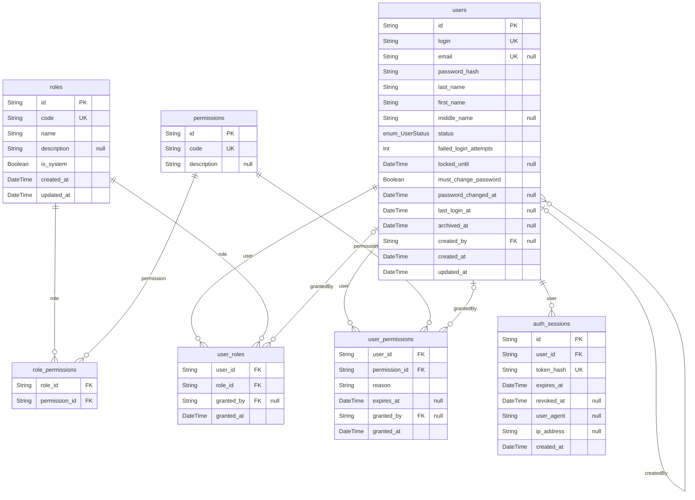

## Группы, дисциплины, студенты

- `groups` — Учебные группы.
- `disciplines` — Учебные дисциплины.
- `teacher_assignments` — Закрепление преподавателя за группой и дисциплиной — основа scope доступа (FR-002).
- `students` — Профили студентов. ФИО — ПДн; в исследовательских выборках используется код участника.
- `enrollments` — Принадлежность студента к группе во времени: перевод закрывает запись и открывает новую (FR-010).
- `pedagogical_observations` — Педагогические наблюдения с датой и автором (FR-014). По умолчанию — служебные (FR-016).

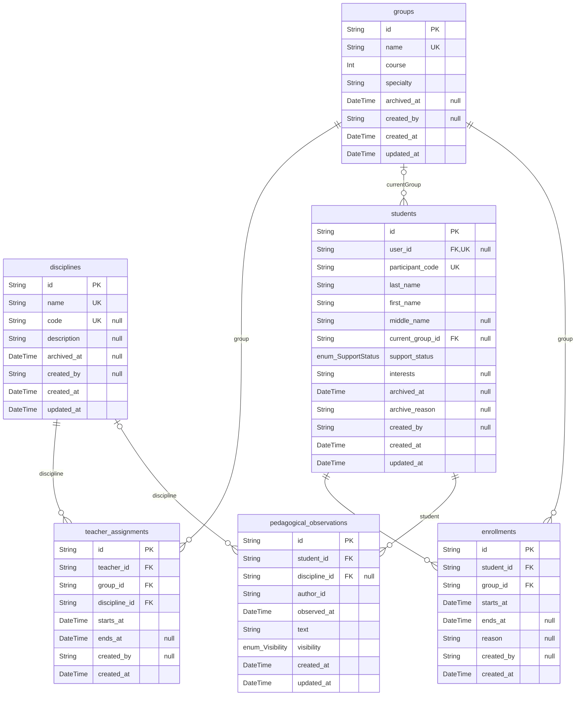

## Диагностика

- `diagnostic_directions` — Настраиваемые диагностические направления (п. 4.4).
- `questionnaires` — Методика — постоянная сущность; содержание и ключи живут в версиях.
- `questionnaire_versions` — Версия методики со всеми полями п. 4.4. После публикации не изменяется (FR-026).
- `questionnaire_version_comparabilities` — Сопоставимость двух версий методики, утверждённая исследователем (UC-06, FR-072).
- `questions` — Вопросы версии методики.
- `answer_options` — Варианты ответов на вопросы с выбором.
- `questionnaire_scales` — Шкалы методики (FR-021: несколько шкал).
- `scoring_keys` — Ключ начисления баллов: вклад вопроса (или конкретного варианта) в шкалу; обратное кодирование.
- `interpretation_rules` — Правила интерпретации: диапазон баллов шкалы → уровень и текст.
- `diagnostic_assignments` — Назначение методики студенту или группе на период (FR-018, FR-019).
- `diagnostic_sessions` — Прохождение методики студентом (UC-01). Хранит версию, даты и время прохождения (FR-023).
- `diagnostic_revisions` — Ревизии результатов сессии: исправление ошибочного ввода (FR-013) или пересчёт по новой версии ключей (FR-026).
- `diagnostic_answers` — Исходные ответы. Записываются при завершении и не изменяются; исправление добавляет строку с новой ревизией (FR-013).
- `diagnostic_scores` — Рассчитанные показатели по шкалам для каждой ревизии сессии. Пропуск = null, не 0 (FR-074).

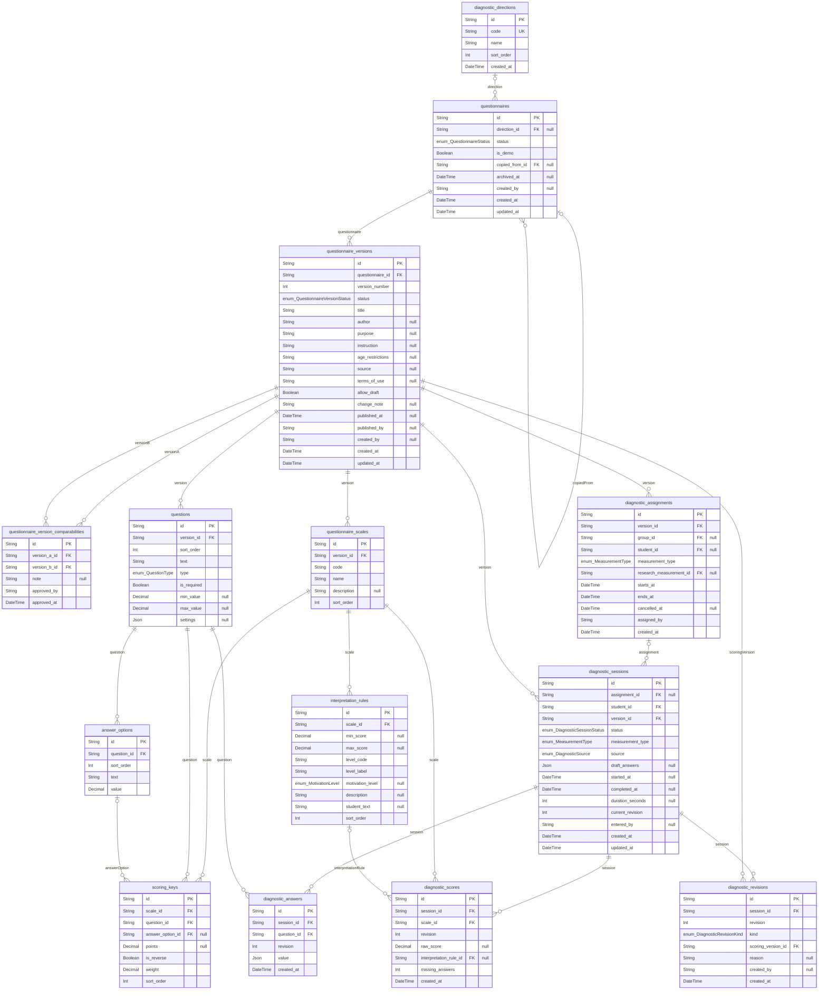

## Мотивационные профили

- `motivation_profiles` — Мотивационный профиль: предложение системы и решение преподавателя (FR-027–FR-029).
- `motivation_profile_sources` — Диагностические сессии, на основании которых сформирован профиль.
- `motivation_profile_history` — История изменений профиля (FR-032).

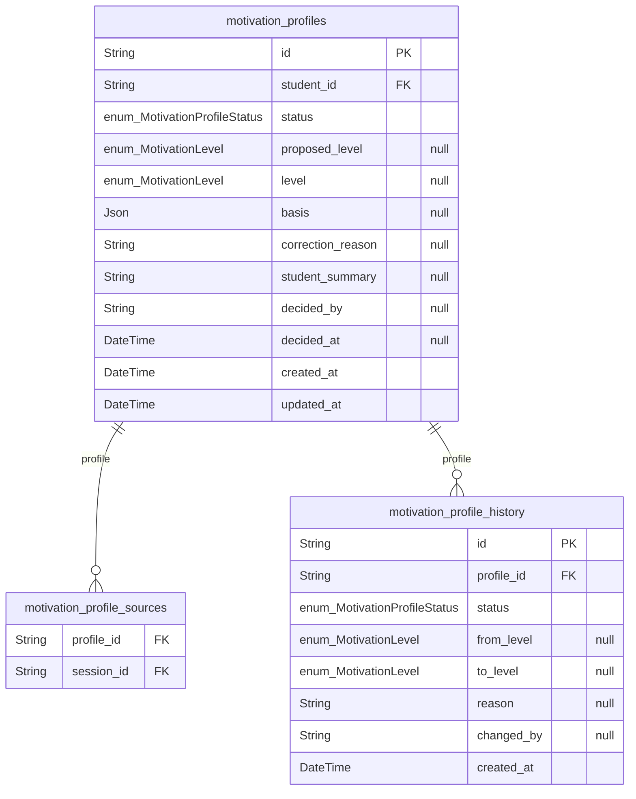

## Файлы и материалы

- `files` — Загруженные файлы. Содержимое — в локальном хранилище под случайным именем, выдача только через API.
- `materials` — Библиотека материалов: файлы, ссылки, тексты.

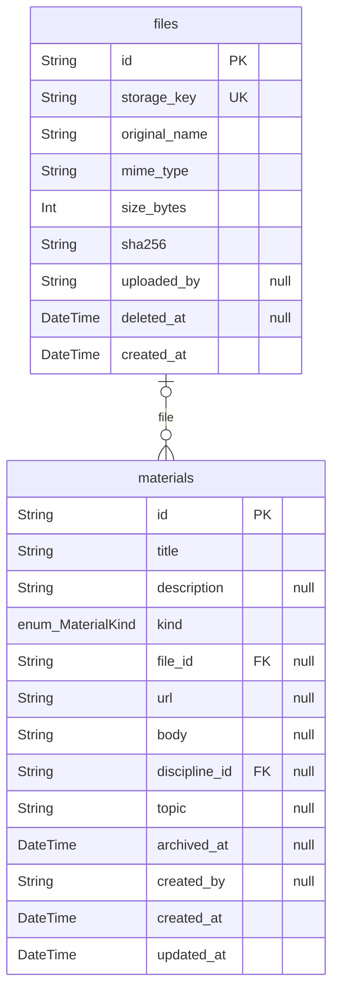

## Траектории (ИОТ)

- `trajectory_templates` — Шаблоны ИОТ; стандартный пятиэтапный и варианты под профили (FR-034, FR-035).
- `trajectory_template_stages` — Этапы шаблона ИОТ; копируются в trajectory_stages при создании маршрута.
- `trajectories` — Индивидуальная траектория — паспорт ИОТ (п. 4.6). У студента может быть несколько ИОТ (FR-045). Текущее содержимое редактируется здесь и в trajectory_stages; каждая утверждённая или скорректированная редакция фиксируется снимком в trajectory_versions (FR-043).
- `trajectory_versions` — Зафиксированные версии ИОТ: неизменяемый снимок паспорта, этапов и заданий + причина (FR-043, UC-05).
- `trajectory_stages` — Этапы маршрута (стандартно пять, п. 4.6). Удалённый при корректировке этап архивируется.
- `trajectory_checkpoints` — Контрольные точки этапов (п. 6.4, FR-058).
- `stage_materials` — Материалы, назначенные этапу (FR-037).

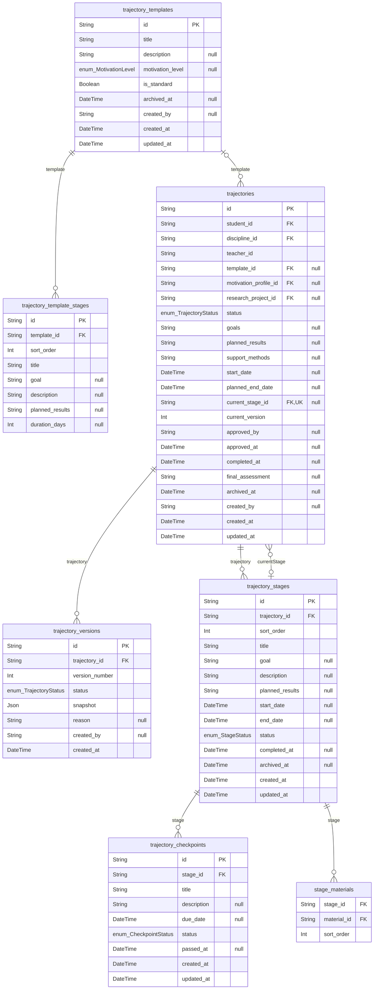

## Задания

- `assignment_types` — Типы заданий: стандартные из п. 4.7 и добавленные пользователями.
- `assignments` — Библиотека заданий (FR-046, FR-047).
- `assessment_criteria` — Критерии оценивания задания (FR-052).
- `assignment_attachments` — Файлы и ссылки, прикреплённые к заданию (FR-049).
- `assignment_choice_groups` — Набор равнозначных заданий, из которых студент выбирает (FR-054).
- `trajectory_assignments` — Назначение задания конкретному студенту (FR-048), при наличии — в рамках этапа ИОТ.
- `submissions` — Попытки сдачи задания (FR-050, FR-051). Каждая повторная сдача — новая попытка.
- `submission_files` — Файлы, приложенные к попытке сдачи.
- `assessments` — Результат проверки попытки: решение, оценка, комментарий для студента (FR-052).
- `assessment_criterion_scores` — Баллы проверки по каждому критерию оценивания.

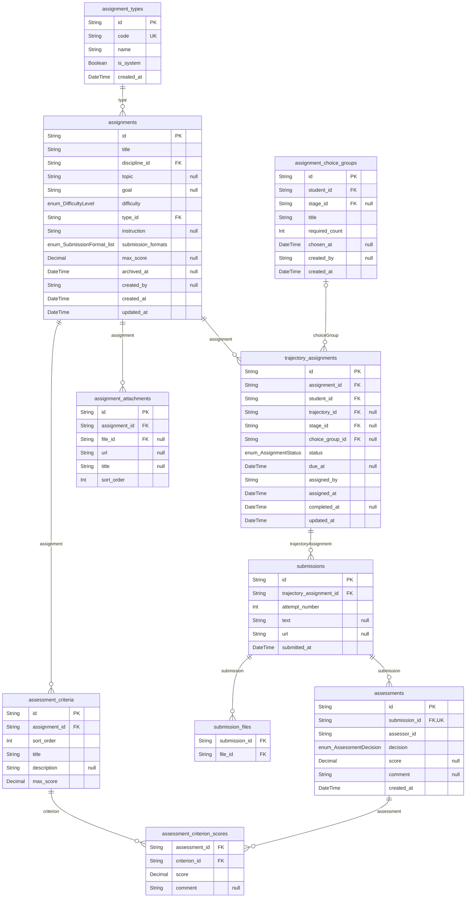

## Сопровождение и обратная связь

- `feedback` — Педагогическая обратная связь и обращения студента; привязка к студенту, этапу или заданию (FR-064).
- `consultations` — Консультации: запрос, назначение, проведение, история (FR-067).
- `reflections` — Самооценка и рефлексия студента, в том числе после контрольной точки (FR-066).
- `academic_results` — Учебные достижения: оценки за задания и вручную внесённые результаты.

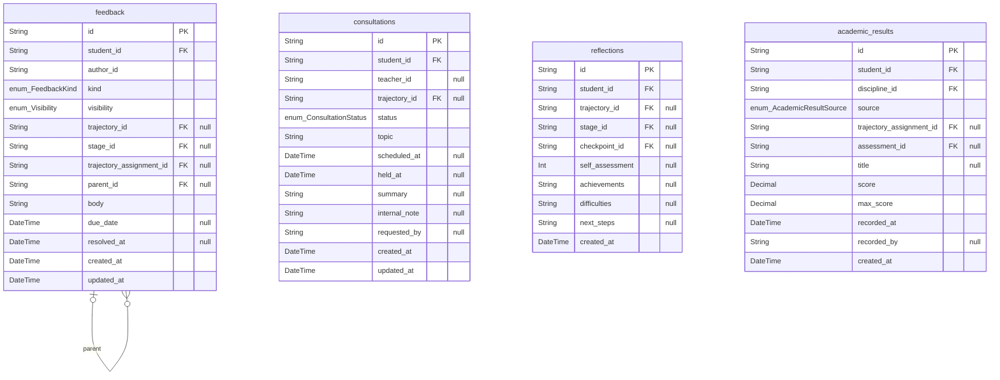

## Исследование

- `research_projects` — Исследовательские проекты (п. 4.10).
- `research_participants` — Участники исследования: исследовательский код и группа (ЭГ/КГ).
- `research_measurements` — Замеры исследования (первичный, повторный) по конкретной версии методики (FR-072).

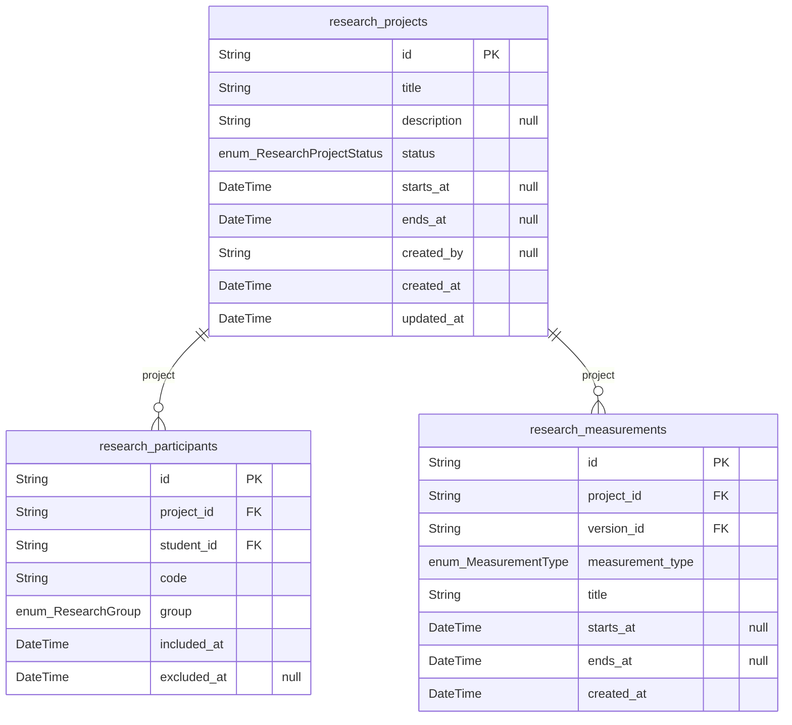

## Служебные

- `audit_logs` — Журнал значимых действий (п. 8.3). Записи не изменяются и не удаляются.
- `notifications` — Внутрисистемные уведомления (бейдж в шапке).
- `idempotency_keys` — Ключи идемпотентности форм (NFR-006): повтор запроса возвращает сохранённый ответ.
- `system_settings` — Системные настройки (в том числе тексты стратегий для трёх профилей, FR-030).

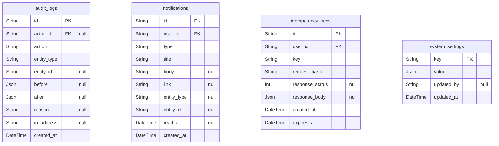
