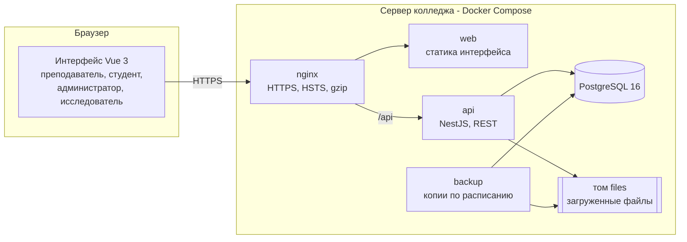

# Обзор архитектуры

Веб-приложение цифрового сопровождения индивидуальных образовательных траекторий (ИОТ) студентов колледжа. Документ описывает состав системы и связи частей; подробности — в документах, на которые он ссылается.

| Документ                                     | Содержание                                                          |
| -------------------------------------------- | ------------------------------------------------------------------- |
| [data-model.md](data-model.md)               | Таблицы, жизненные циклы статусов, неизменяемость и версионирование |
| [er-diagram.md](er-diagram.md)               | ER-диаграмма базы данных (формируется из схемы Prisma)              |
| [access-model.md](access-model.md)           | Роли, разрешения, область данных, сессия, аудит                     |
| [../spec/decisions.md](../spec/decisions.md) | Архитектурные решения (ADR) и их причины                            |
| [../api/README.md](../api/README.md)         | Документация API, `openapi.json`                                    |
| [../deploy/README.md](../deploy/README.md)   | Состав рабочего сервера, установка, резервное копирование           |
| [../design/](../design/tokens.md)            | Дизайн-токены, карта навигации, макеты экранов                      |

## Общая схема

- Интерфейс — одностраничное приложение; все данные получает из REST API `/api` (JSON).
- Сервер API проверяет вход, разрешения и область данных на каждом запросе; интерфейс скрывает недоступное только для удобства.
- Файлы (материалы, вложения заданий, ответы студентов) хранятся на томе `files` и выдаются только через API с проверкой прав.
- Наружу открыт только nginx; база и API находятся во внутренней сети Docker. Подробнее — [../deploy/README.md](../deploy/README.md).

## Технологии

| Слой             | Решение                                                                                                                      |
| ---------------- | ---------------------------------------------------------------------------------------------------------------------------- |
| Монорепозиторий  | pnpm workspaces, Node.js 24 LTS, TypeScript                                                                                  |
| Серверная часть  | NestJS (ESM), `class-validator`, `@nestjs/swagger` (OpenAPI на `/api/docs`)                                                  |
| База данных      | PostgreSQL 16, Prisma (схема и миграции — `apps/api/prisma`)                                                                 |
| Аутентификация   | Access JWT (15 мин) + refresh-токен в cookie httpOnly/Secure/SameSite=Strict с ротацией, CSRF double submit, пароли argon2id |
| Интерфейс        | Vue 3, Vite, Vue Router, Pinia, PrimeVue 4.5, Chart.js (vue-chartjs), VeeValidate + zod                                      |
| Импорт и экспорт | CSV — papaparse, XLSX — exceljs, PDF — pdfmake (шрифт Roboto с кириллицей)                                                   |
| Журнал сервера   | pino с маскированием персональных данных                                                                                     |
| Тесты            | Jest + supertest (API), Vitest (общий пакет и интерфейс), Playwright (сквозные и приёмка), k6 (нагрузка)                     |
| Развёртывание    | Docker Compose: nginx, web, api, postgres, backup                                                                            |

Перечень библиотек и лицензий — [../licenses.md](../licenses.md).

## Структура репозитория

| Каталог           | Назначение                                                                                                                                            |
| ----------------- | ----------------------------------------------------------------------------------------------------------------------------------------------------- |
| `apps/api`        | Серверная часть: модули NestJS (`src/`), схема и миграции БД (`prisma/`), e2e-тесты (`test/`)                                                         |
| `apps/web`        | Интерфейс: экраны (`src/views/`), макеты страниц (`src/layouts/`), общие компоненты (`src/components/`), тема (`src/theme/`), сквозные тесты (`e2e/`) |
| `packages/shared` | Общий код сервера и интерфейса: перечисления статусов, схемы zod, каталог разрешений, правила расчёта                                                 |
| `docker/`         | Dockerfile образов, конфигурация nginx, скрипты резервного копирования и тест восстановления                                                          |
| `scripts/`        | Служебные скрипты репозитория (перечень лицензий)                                                                                                     |
| `docs/`           | Документация                                                                                                                                          |

### Общий пакет `packages/shared`

Правила, которые должны совпадать на сервере и в интерфейсе, вынесены в общий пакет и покрыты модульными тестами:

- каталог ролей и разрешений (`auth.ts`), названия статусов (`enums.ts`);
- движок расчёта методик и проверки публикации (`diagnostics.ts`);
- правила предложения мотивационного профиля (`motivation-profiles.ts`);
- допустимые переходы статусов ИОТ и учёт выполнения этапов (`trajectories.ts`, `submissions.ts`);
- показатели мониторинга, главной панели и описательные статистики (`monitoring.ts`, `dashboard.ts`, `statistics.ts`);
- состав отчётов и исследовательских выгрузок (`reports.ts`, `research.ts`, `diagnostic-results.ts`).

### Модули серверной части `apps/api/src`

| Модуль                  | Ответственность                                                                                                                        |
| ----------------------- | -------------------------------------------------------------------------------------------------------------------------------------- |
| `auth`                  | Вход, refresh, выход, смена пароля, ограничение попыток, guard'ы разрешений, область данных (`access-scope.service.ts`), каталог ролей |
| `users`                 | Учётные записи сотрудников, роли, индивидуальные разрешения                                                                            |
| `audit`                 | Журнал аудита (запись и просмотр)                                                                                                      |
| `settings`              | Системные настройки                                                                                                                    |
| `groups`, `disciplines` | Учебные группы, дисциплины, закрепление преподавателей                                                                                 |
| `students`              | Студенты, импорт, перевод, архив, профиль студента и педагогические наблюдения                                                         |
| `diagnostics`           | Конструктор методик и версии, назначение и прохождение диагностики, ревизии, сравнение замеров, обезличенная выгрузка                  |
| `profiles`              | Мотивационные профили и стратегии сопровождения                                                                                        |
| `library`               | Материалы, задания библиотеки, типы заданий, безопасная загрузка файлов (проверка сигнатуры)                                           |
| `trajectories`          | Шаблоны и конструктор ИОТ, утверждение, версии, кабинет студента (траектория)                                                          |
| `assignments`           | Назначение заданий, выбор из равнозначных, сдача, проверка по критериям                                                                |
| `monitoring`            | Показатели выполнения ИОТ, предупреждения (фоновая проверка раз в час), корректировка, завершение                                      |
| `feedback`              | Сообщения, обращения студентов, консультации, рефлексия                                                                                |
| `notifications`         | Внутрисистемные уведомления                                                                                                            |
| `dashboard`             | Главная панель преподавателя и главная студента                                                                                        |
| `analytics`             | Аналитика, исследования, участники ЭГ/КГ, замеры, экспорт                                                                              |
| `reports`               | Отчёты PDF и XLSX                                                                                                                      |
| `common`                | Единый формат ошибок, защита от повторной отправки форм (`Idempotency-Key`), контекст запроса                                          |
| `logging`               | Журнал запросов с маскированием персональных данных                                                                                    |
| `cli`                   | `create-admin` (первый администратор на рабочем сервере), `export-openapi` (документация API)                                          |

## Сквозные механизмы

| Механизм                    | Реализация                                                                                                                                                |
| --------------------------- | --------------------------------------------------------------------------------------------------------------------------------------------------------- |
| Проверка прав               | Каждый маршрут API объявляет разрешение; автотест `route-guards` проверяет, что маршрутов без него нет; IDOR-тест — что чужие идентификаторы дают 403/404 |
| Область данных              | Преподаватель — свои группы и дисциплины; студент — только свои данные; исследователь — только обезличенные                                               |
| Скрытые от студента данные  | Внутренние заметки и служебные наблюдения отфильтровываются на сервере во всех ответах кабинета и в отчётах                                               |
| Неизменяемость              | Опубликованные версии методик, завершённые ответы диагностики, утверждённые версии ИОТ и журнал аудита защищены триггерами базы данных                    |
| Версионирование             | Изменение ключей методики — новая версия; корректировка ИОТ — новая версия с причиной; прежние сохраняются                                                |
| Повторная отправка форм     | Заголовок `Idempotency-Key`: повтор возвращает прежний результат, не создавая дубль                                                                       |
| Аудит                       | Изменения ИОТ, диагностики, профилей, прав, настроек, экспорты и отчёты пишутся в `audit_logs`                                                            |
| Персональные данные в логах | Журнал запросов не содержит тел запросов, query-параметров, ФИО, e-mail, телефонов, ИИН                                                                   |
| «Нет данных»                | Пропуски передаются как `null` и показываются как «Нет данных», а не как ноль                                                                             |
| Уведомления                 | Таблица `notifications`; интерфейс опрашивает счётчик и показывает бейдж в шапке                                                                          |
| Фоновые задачи              | Внутри процесса API: проверка просрочек и пропущенных контрольных точек и очистка ключей повторной отправки — раз в час                                   |

## Окружения

У разработки (`iot_dev`), автотестов (`iot_test`), приёмочного стенда (`iot_acceptance`), нагрузочного теста (`iot_load`) и рабочего сервера — отдельные базы, каталоги файлов и файлы переменных окружения (NFR-010). Рабочее окружение — [../deploy/environment.md](../deploy/environment.md).

## Тестирование

| Уровень                       | Где                                                                     | Команда                                 |
| ----------------------------- | ----------------------------------------------------------------------- | --------------------------------------- |
| Модульные: общий пакет        | `packages/shared/src/*.spec.ts`                                         | `pnpm test`                             |
| Модульные: API                | `apps/api/src/**/*.spec.ts` (в т. ч. контрольные примеры методик)       | `pnpm test`                             |
| e2e API на тестовой базе      | `apps/api/test/*.e2e-spec.ts`                                           | `pnpm test`                             |
| Модульные: интерфейс          | `apps/web/src/**/*.spec.ts`                                             | `pnpm test`                             |
| Интерфейс в браузерах         | `apps/web/e2e/*.spec.ts` (Chromium, Firefox, 360 px; WebKit — в Docker) | `pnpm test:e2e`, `pnpm test:e2e:webkit` |
| Приёмка AT-01…AT-12           | `apps/web/e2e/acceptance/`                                              | `pnpm test:acceptance`                  |
| Восстановление из копии AT-13 | `docker/test/`                                                          | `pnpm test:restore`                     |
| Нагрузка 50 пользователей     | `apps/api/test/load/`                                                   | `pnpm test:load`                        |

Сценарии по модулям — [../testing/scenarios/README.md](../testing/scenarios/README.md), результаты — [../testing/results.md](../testing/results.md).
