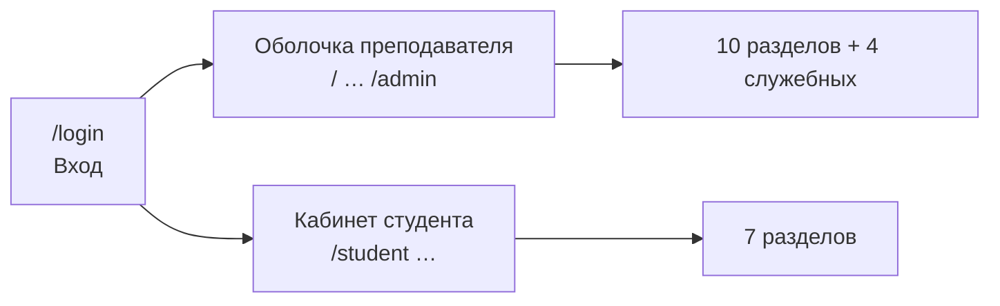

# Карта навигации

Структура навигации задана ТЗ (п. 3.1, 3.2) и не меняется без согласования с заказчиком (огр. 7). Единственный источник — `apps/web/src/navigation.ts`: из него строятся меню и маршруты (`apps/web/src/router/index.ts`). Порядок и названия пунктов проверяются тестом `apps/web/src/navigation.spec.ts`.

## Рабочее место преподавателя

Оболочка `StaffLayout`. Основное меню:

| №   | Пункт                     | Адрес                  | Этап реализации |
| --- | ------------------------- | ---------------------- | --------------- |
| 1   | Главная                   | `/`                    | 16              |
| 2   | Студенты                  | `/students`            | 04, 05          |
| 3   | Диагностика               | `/diagnostics`         | 06, 07, 08      |
| 4   | Мотивационные профили     | `/motivation-profiles` | 09              |
| 5   | Индивидуальные траектории | `/trajectories`        | 11, 12, 14      |
| 6   | Задания                   | `/assignments`         | 10, 13          |
| 7   | Мониторинг                | `/monitoring`          | 14              |
| 8   | Обратная связь            | `/feedback`            | 15              |
| 9   | Аналитика                 | `/analytics`           | 17              |
| 10  | Отчёты                    | `/reports`             | 18              |

Служебные разделы:

| Пункт                 | Адрес          | Этап реализации |
| --------------------- | -------------- | --------------- |
| Дисциплины            | `/disciplines` | 04              |
| Библиотека материалов | `/library`     | 10              |
| Настройки             | `/settings`    | 03, 09          |
| Администрирование     | `/admin`       | 03              |

Вложенные страницы (не пункты меню; в меню подсвечивается родительский раздел):

| Страница         | Адрес           | Раздел   | Этап |
| ---------------- | --------------- | -------- | ---- |
| Профиль студента | `/students/:id` | Студенты | 05   |

Профиль открывается по имени студента в списке; ссылка «← Студенты» возвращает к списку (ADR-011).

Раздел «Дисциплины» содержит вкладки «Дисциплины», «Учебные группы» (разрешение `groups.manage`) и «Закрепление преподавателей» (`disciplines.manage`). Преподаватель видит в разделе только свои дисциплины без вкладок управления. Отдельного пункта меню для групп нет — структура меню не меняется (ADR-010).

Шапка: название системы, выбор группы, выбор дисциплины, уведомления, профиль пользователя. Списки групп и дисциплин содержат только доступные пользователю значения (FR-002); выбор запоминается в браузере и действует как фильтр раздела «Студенты» (на этапе 16 — и главной панели).

Без входа любой адрес ведёт на `/login`; студент открывает только `/student/*`, сотрудник — только рабочее место.

Оболочкой пользуются все сотрудники. Пункт виден, если у пользователя есть разрешение раздела (`permission` в `navigation.ts`, модель прав — `docs/architecture/access-model.md`); порядок видимых пунктов не меняется. По прямой ссылке раздел без прав показывает «Нет доступа к разделу». Навигация администратора и исследователя в ТЗ не задана (открытый вопрос № 13), до ответа заказчика действует такое распределение:

| Роль          | Видимые пункты                                             |
| ------------- | ---------------------------------------------------------- |
| Преподаватель | 10 основных пунктов, «Дисциплины», «Библиотека материалов» |
| Администратор | «Главная», «Дисциплины», «Настройки», «Администрирование»  |
| Исследователь | «Главная», «Аналитика», «Отчёты»                           |

«Настройки» сейчас содержат только системные параметры, поэтому доступны администратору; если на этапе 09 преподавателям понадобится редактировать тексты стратегий, раздел станет доступен и им.

Меню профиля в шапке: ФИО и роль пользователя, «Сменить пароль», «Выйти».

## Кабинет студента

Оболочка `StudentLayout`.

| №   | Пункт          | Адрес                   | Подпись в нижней панели | Этап реализации |
| --- | -------------- | ----------------------- | ----------------------- | --------------- |
| 1   | Главная        | `/student`              | Главная                 | 16              |
| 2   | Моя траектория | `/student/trajectory`   | Траектория              | 12              |
| 3   | Мои задания    | `/student/assignments`  | Задания                 | 12, 13          |
| 4   | Диагностика    | `/student/diagnostics`  | Диагностика             | 07              |
| 5   | Мои достижения | `/student/achievements` | — (меню «Ещё»)          | 16              |
| 6   | Обратная связь | `/student/feedback`     | — (меню «Ещё»)          | 15              |
| 7   | Мой профиль    | `/student/profile`      | — (меню «Ещё»)          | 05              |

На экранах уже 1024 px внизу закреплена панель из первых четырёх пунктов и кнопки «Ещё»; «Ещё» открывает выдвижную панель со всеми семью пунктами в порядке ТЗ. На широком экране — левое меню. Пункты «Мои достижения», «Обратная связь» и «Мой профиль» на смартфоне открываются через «Ещё».

## Прочие адреса

| Адрес               | Назначение                                                                |
| ------------------- | ------------------------------------------------------------------------- |
| `/login`            | Вход в систему; после входа — запрошенная страница или главная своей роли |
| `/account/password` | Смена пароля; обязательна после входа с временным паролем                 |
| любой другой        | Страница «Страница не найдена» со ссылкой на главную                      |

