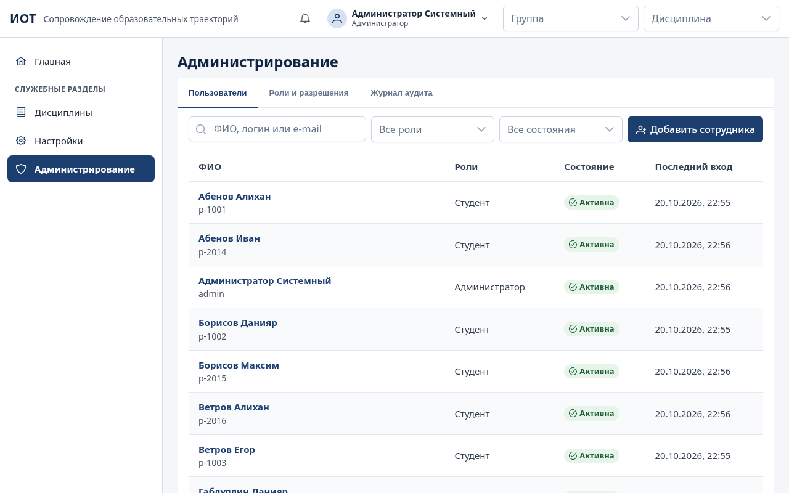
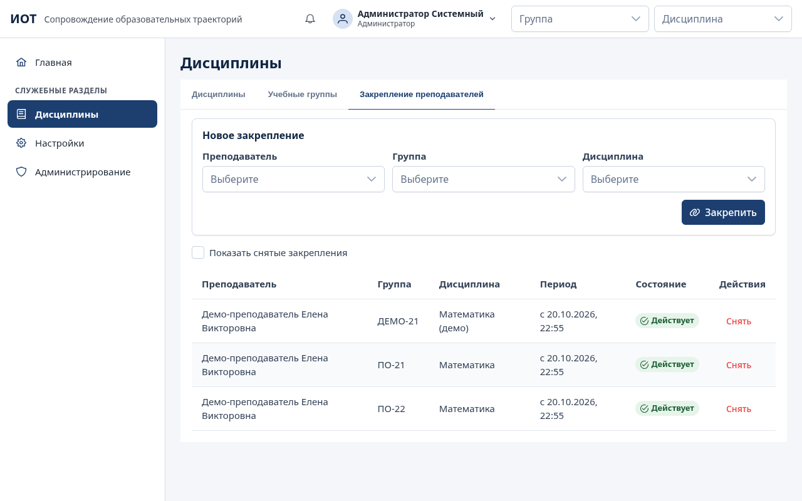
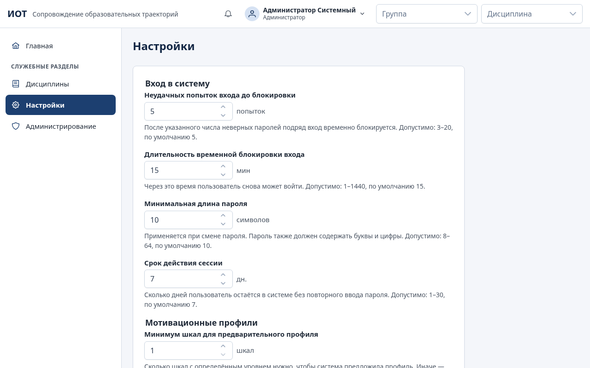
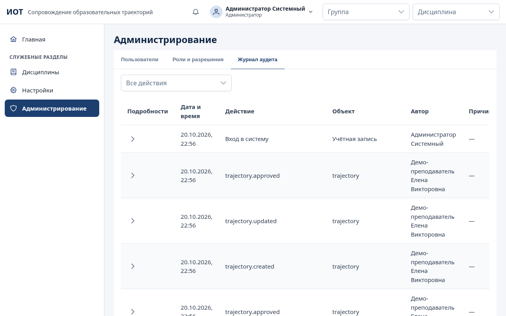

# Руководство администратора

Администратор отвечает за учётные записи сотрудников, справочники (группы, дисциплины, закрепление преподавателей), системные настройки и журнал аудита. Установка, обновление и резервное копирование сервера описаны отдельно — в [../deploy/README.md](../deploy/README.md).

## Что может и чего не может администратор

| Может                                                                                                         | Не может (без отдельного разрешения)                            |
| ------------------------------------------------------------------------------------------------------------- | --------------------------------------------------------------- |
| Создавать учётные записи сотрудников, назначать роли                                                          | Видеть ответы студентов на диагностические методики (п. 2.1 ТЗ) |
| Блокировать и разблокировать учётные записи, сбрасывать пароли                                                | Работать в разделах преподавателя: диагностика, ИОТ, задания    |
| Выдавать и отзывать индивидуальные разрешения с указанием основания                                           | Изменять свои собственные роли                                  |
| Вести группы, дисциплины и закрепление преподавателей                                                         | Изменять или удалять записи журнала аудита                      |
| Менять системные настройки и тексты стратегий сопровождения                                                   |                                                                 |
| Просматривать журнал аудита                                                                                   |                                                                 |
| Вести студентов всех групп: добавлять, импортировать, изменять ФИО, переводить, архивировать, выдавать пароль |                                                                 |

Студентов добавляют администратор или преподаватели в разделе «Студенты» (порядок действий — [teacher.md](teacher.md), раздел 3); там же создаются учётные записи студентов. Администратор видит студентов всех групп без закреплений; ответы студентов на диагностические методики ему по-прежнему недоступны.

## Вход в систему

1. Откройте адрес системы, выданный при установке (например, `https://iot.college.local`).
2. Введите логин и пароль, нажмите «Войти».
3. Первый администратор создаётся при установке командой `create-admin` с временным паролем ([../deploy/install.md](../deploy/install.md)). При первом входе система попросит сменить временный пароль: до смены другие разделы недоступны.

Смена своего пароля — меню профиля в правом верхнем углу → «Сменить пароль». При смене пароля другие открытые сеансы этой учётной записи завершаются.

После пяти неверных паролей подряд вход временно блокируется на 15 минут (значения меняются в «Настройках»). Неверный логин и неверный пароль дают одинаковое сообщение «Неверный логин или пароль» — так нельзя подобрать существующие логины.

## Навигация

Администратору доступны пункты «Главная», «Студенты», «Дисциплины», «Настройки» и «Администрирование»; остальные пункты меню преподавателя скрыты. В профиле студента вкладки ИОТ и заданий показывают пояснение «Нет доступа». Порядок пунктов не меняется.

## Учётные записи сотрудников

### Добавить сотрудника

1. «Администрирование» → вкладка «Пользователи» → «Добавить сотрудника».
2. Заполните логин (латинские буквы, цифры, точка, дефис, `_`, от 3 до 64 символов), фамилию, имя, отчество (если есть), электронную почту (необязательно).
3. Отметьте роли: «Администратор», «Преподаватель», «Исследователь». У одного сотрудника может быть несколько ролей.
4. Нажмите «Создать». Система покажет **временный пароль один раз** — передайте его сотруднику лично. При первом входе сотрудник обязан задать свой пароль.

Повторная отправка формы (например, двойной щелчок) не создаёт вторую учётную запись.

### Найти, заблокировать, сбросить пароль

- Поиск — по ФИО, логину или e-mail; фильтры — по роли и состоянию («Активна», «Заблокирована», «В архиве»).
- Откройте учётную запись щелчком по строке. В карточке:
  - «Сохранить данные» — изменение ФИО и e-mail;
  - «Сохранить роли» — изменение ролей (свои роли изменить нельзя);
  - «Заблокировать» / «Разблокировать» — блокировка сразу завершает все сеансы пользователя;
  - «Сбросить пароль» — выдаёт новый временный пароль, показанный один раз.

Пароли студентов сбрасывают администратор или преподаватель в профиле студента («Управление карточкой» → «Новый пароль»).

### Индивидуальные разрешения

Роль задаёт обычный набор прав. Сверх него можно выдать отдельное разрешение конкретному сотруднику — например, исследователю доступ к персональным данным участников.

1. Карточка пользователя → блок «Индивидуальные разрешения».
2. «Выберите разрешение» → укажите основание (номер приказа, согласие и т. п.) → «Выдать разрешение».
3. Для отзыва — «Отозвать» у разрешения, с указанием причины.

Конфиденциальные разрешения отмечены пометкой «Конфиденциально»:

| Разрешение                                           | Что открывает                                                          |
| ---------------------------------------------------- | ---------------------------------------------------------------------- |
| Доступ к содержанию диагностических ответов          | Исходные ответы студентов на методики (по умолчанию — у преподавателя) |
| Просмотр персональных данных участников исследования | ФИО участников исследования вместо кодов (исследователю)               |

Выдача и отзыв записываются в журнал аудита. Порядок оформления таких разрешений определяет колледж (см. [../spec/open-questions.md](../spec/open-questions.md), вопросы 5 и 6).

Вкладка «Роли и разрешения» показывает, какие разрешения входят в каждую роль. Состав ролей задан в системе; полное описание — [../architecture/access-model.md](../architecture/access-model.md).

## Справочники: дисциплины, группы, закрепление преподавателей

Раздел «Дисциплины» (служебный) содержит три вкладки.

| Вкладка                    | Действия                                                                                                                                      |
| -------------------------- | --------------------------------------------------------------------------------------------------------------------------------------------- |
| Дисциплины                 | «Добавить дисциплину»: название, код (если есть), описание. «Изменить», «В архив», «Вернуть из архива»                                        |
| Учебные группы             | «Добавить группу»: название, курс, специальность. Группу, в которой есть студенты, архивировать нельзя                                        |
| Закрепление преподавателей | Выберите преподавателя, группу и дисциплину → «Закрепить». «Снять» завершает закрепление, история сохраняется («Показать снятые закрепления») |

Закрепление определяет, каких студентов видит преподаватель: только студентов групп, за которыми он закреплён, и только по своим дисциплинам. Преподаватель без закреплений видит пояснение «нет закреплённых групп». Названия дисциплин и групп должны быть уникальны — повтор отклоняется с понятным сообщением.

Рекомендуемый порядок подготовки к учебному году: дисциплины → группы → учётные записи преподавателей → закрепления → импорт студентов преподавателями.

## Настройки

| Настройка                                 | По умолчанию | Допустимо     |
| ----------------------------------------- | ------------ | ------------- |
| Неудачных попыток входа до блокировки     | 5            | 3–20          |
| Длительность временной блокировки входа   | 15 мин       | 1–1440 мин    |
| Минимальная длина пароля                  | 10 символов  | 8–64 символов |
| Срок действия сессии                      | 7 дней       | 1–30 дней     |
| Минимум шкал для предварительного профиля | 1            | 1–10          |

Под каждым полем показаны допустимый диапазон и значение по умолчанию. Значение вне диапазона не сохраняется. Изменения записываются в журнал аудита.

Ниже — **«Стратегии сопровождения для мотивационных профилей»**: тексты стратегий для высокого, среднего и низкого уровня (п. 4.5 ТЗ). Исходно в них формулировки ТЗ. Изменённые тексты сразу видны преподавателям в карточках профилей; преподаватели менять их не могут. Кнопка — «Сохранить стратегии».

«Минимум шкал для предварительного профиля» — сколько шкал методики должны указывать на один уровень, чтобы система предложила профиль. Если шкал меньше, профиль получает статус «Требуется дополнительная диагностика».

## Журнал аудита

«Администрирование» → «Журнал аудита». Новые записи — сверху. Фильтр по действию; щелчок по записи открывает подробности: дата и время, действие, объект и его идентификатор, автор, IP-адрес, причина (если указывалась) и изменённые поля.

В журнал попадают:

- входы, неудачные попытки входа, временные блокировки, выходы, смена и сброс паролей;
- создание и изменение учётных записей, ролей и индивидуальных разрешений;
- изменения настроек и справочников;
- изменения методик и их версий, назначение диагностики, ввод бланков и исправление ответов;
- подтверждение и корректировка мотивационных профилей;
- добавление, импорт, перевод и архивирование студентов, педагогические наблюдения;
- создание, утверждение, корректировка, завершение и архивирование ИОТ, назначение и сдача заданий;
- обезличенные выгрузки, экспорт исследовательских данных и формирование отчётов.

Записи журнала нельзя изменить или удалить — это защищено и на уровне базы данных. Персональные данные (ФИО, e-mail, пароли) в журнал запросов сервера не записываются.

## Обслуживание сервера

| Задача                                 | Документ                                                             |
| -------------------------------------- | -------------------------------------------------------------------- |
| Требования к серверу                   | [../deploy/server-requirements.md](../deploy/server-requirements.md) |
| Установка                              | [../deploy/install.md](../deploy/install.md)                         |
| Переменные окружения                   | [../deploy/environment.md](../deploy/environment.md)                 |
| Обновление версии                      | [../deploy/update.md](../deploy/update.md)                           |
| Резервное копирование и восстановление | [../deploy/backup-restore.md](../deploy/backup-restore.md)           |
| Проверка на сервере колледжа (AT-14)   | [../acceptance/at-14-server.md](../acceptance/at-14-server.md)       |

## Частые вопросы

**Сотрудник забыл пароль.** Карточка пользователя → «Сбросить пароль», передайте временный пароль лично.

**Сотрудник заблокирован после неверных паролей.** Временная блокировка снимается сама через 15 минут. Если нужно раньше — «Разблокировать».

**Преподаватель не видит студентов.** Проверьте закрепление на вкладке «Закрепление преподавателей» и выбор группы в шапке приложения.

**Нужно передать исследователю ФИО участников.** Только через индивидуальное разрешение «Просмотр персональных данных участников исследования» с основанием; без него исследователь видит коды.
