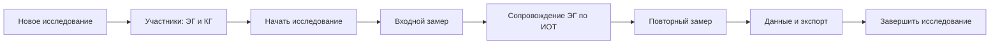
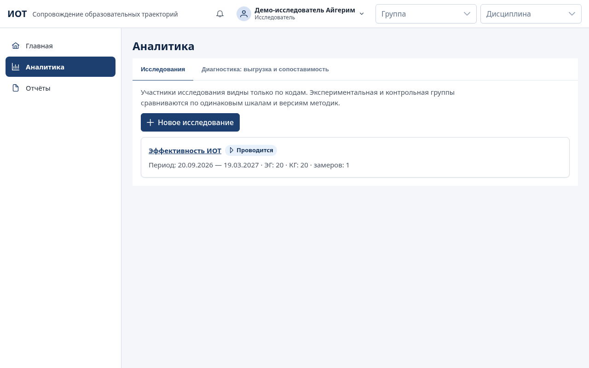
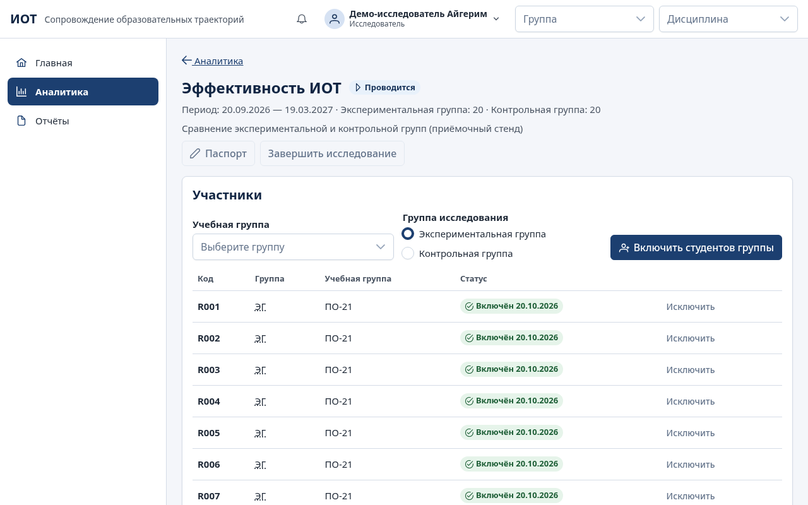

# Руководство исследователя

Исследовательский режим нужен, чтобы оценить эффективность ИОТ: сравнить экспериментальную группу (ЭГ), студенты которой работают по индивидуальным траекториям, с контрольной группой (КГ), и выгрузить сопоставимые обезличенные данные для статистической обработки (UC-07).

## Доступ и персональные данные

- Исследователь работает только с **обезличенными данными**: вместо ФИО — коды участников исследования (`R001`, `R002`, …). Логины, ФИО и контакты в экраны и выгрузки исследователя не попадают.
- Доступ к ФИО участников возможен только по отдельному разрешению «Просмотр персональных данных участников исследования», которое администратор выдаёт индивидуально с основанием. Выдача и отзыв фиксируются в журнале аудита.
- Исследователь не видит педагогических разделов (студенты, ИОТ, задания, мониторинг) и не формирует отчёты по студентам и группам — их формируют преподаватели. В разделе «Отчёты» исследователь увидит пояснение «Нет доступа к отчётам».
- Каждая выгрузка записывается в журнал аудита.

Учётную запись выдаёт администратор; при первом входе нужно сменить временный пароль. Меню исследователя: «Главная», «Аналитика», «Отчёты».

## Порядок проведения исследования

### 1. Создать исследование

«Аналитика» → вкладка «Исследования» → «Новое исследование»: название, описание (необязательно), начало и окончание (необязательно) → «Сохранить». Исследование создаётся в статусе «Подготовка». Изменить паспорт — кнопка «Паспорт».

### 2. Включить участников

1. На странице исследования в блоке «Участники» выберите «Учебная группа» и «Группа исследования»: «Экспериментальная группа» или «Контрольная группа».
2. «Включить студентов группы». Каждый студент получает код участника; уже включённые пропускаются, поэтому повторное нажатие не создаёт дублей.
3. Вверху страницы видна численность: «Экспериментальная группа: N · Контрольная группа: M».

**Контрольная группа не получает экспериментальных ИОТ.** Система не позволит включить в КГ студента, у которого уже есть ИОТ в работе (ответ с кодами таких студентов), и не позволит преподавателю создать или утвердить ИОТ участнику КГ, пока исследование в статусе «Подготовка» или «Проводится».

Выбывшего участника — «Исключить» с причиной. Исключённый участник остаётся в списке с датой исключения и не входит в расчёты.

### 3. Начать исследование

Кнопка «Начать исследование» → «Подтвердить». Статус «Проводится».

### 4. Зафиксировать замеры

«Замеры» → «Новый замер»: название замера (например, «Входной замер»), версия методики, тип замера («Первичный», «Промежуточный», «Повторный»), начало и конец периода → «Сохранить».

Замер привязан к конкретной **версии методики**. В замер попадает прохождение участника по этой версии с тем же типом замера, завершённое в указанный период; если таких несколько — самое раннее. Сами диагностики назначают преподаватели (раздел «Диагностика»); исследователь фиксирует, какие прохождения составляют замер.

Демо-методика (с пометкой «ДЕМО — не для исследования») предназначена только для проверки системы. Для исследования используются утверждённые заказчиком методики, внесённые по инструкции [methodologies.md](methodologies.md).

### 5. Просмотреть данные

Блок «Данные исследования»:

- фильтры «Замеры» и «Шкалы»;
- таблица **«Полные и неполные наблюдения»** по группам: число участников, полных и неполных наблюдений. Незавершённые диагностики в расчёт не входят, но их число показано;
- описательные статистики по каждой шкале, группе и замеру: n, среднее, медиана, стандартное отклонение, минимум, максимум, квартили. Пропуски не заменяются нулями; при одном значении стандартное отклонение не рассчитывается.

Сравниваются только одинаковые шкалы одинаковой версии методики (или версий, сопоставимость которых утверждена — см. ниже).

**Успеваемость и наблюдения на занятиях «до» и «после».** Под фильтрами замеров и шкал выберите:

- «Семестр «до»» и «Семестр «после»» — в списке только семестры, по которым у участников загружены оценки (вкладка «Оценки за семестр» раздела «Академические достижения»). Показатель — общий балл за семестр: среднее средних по дисциплинам, шкала 0–100;
- периоды наблюдений «до» и «после» (даты «с» и «по» включительно; пустая граница — без ограничения). Показатели — средняя оценка 1–5 по каждому критерию журнала наблюдений и средняя по критериям (каждый критерий весит одинаково). Отметки «Не наблюдалось» и «Отсутствовал» оценками не считаются.

Контрольные работы (раздел «Академические достижения») добавляют показатель «Контрольные работы: <дисциплина>» для каждой дисциплины, по которой участники писали входные или итоговые работы: «до» — средний балл входного контроля, «после» — итогового. Отметки «Отсутствовал», «Не выполнил работу», «Освобождён» баллом не считаются. Текущий контроль в показатель не входит.

Если ничего не выбрано, подставляются два последних семестра с оценками участников, период «до» — по день накануне даты начала исследования, «после» — с даты начала до даты окончания (без даты начала периоды не заданы). Семестры не могут совпадать, периоды — пересекаться.

По каждому показателю и группе (ЭГ, КГ) показаны описательные статистики «до», «после» и изменения «после − до» — только у участников, у которых есть оба значения; остальные попадают в колонку «Пропуски». Нет оценок или наблюдений — «Нет данных», а не ноль.

**Статистический анализ эксперимента.** Ниже показателей — сводный анализ ЭГ и КГ:

- сводные карточки: число участников ЭГ и КГ, сколько показателей прошли проверки, по скольким показателям значимый рост в ЭГ и КГ и значимое различие изменений между группами;
- разделы **«Мотивация»** (методики направления «Учебная мотивация»), **«Саморегуляция»** (направление «Саморегуляция»), **«Академические достижения»** (средний балл за семестр, контрольные работы), **«Педагогические наблюдения на занятиях»**. Раздел методики определяется её направлением — его можно указать в карточке методики (раздел «Диагностика»). Баллы разных методик и шкал не складываются: каждая шкала — отдельный показатель;
- в каждом разделе — графики средних «до» и «после» по ЭГ и КГ и долей студентов с ростом, без изменений и со снижением; для контрольных работ — график среднего балла ЭГ и КГ по каждой работе (входной, текущий, итоговый контроль) и таблица;
- карточка показателя (нажмите на название): проверки данных, краткий вывод и две таблицы. Проверки: тип замеров (первичный → повторный), одна версия методики или утверждённая сопоставимость версий, одинаковые код и способ расчёта шкалы в обоих замерах, полнота пар «до — после» в каждой группе, выбор семестров и периодов. Не пройдена проверка версии, шкалы или периодов — изменение и критерии не рассчитываются;
- таблица «внутри групп»: среднее ± стандартное отклонение и медиана «до», «после» и изменения, число пар, число и процент студентов с ростом, без изменений и со снижением, критерий Вилкоксона (T, p, размер эффекта r);
- таблица «ЭГ и КГ»: критерий Манна — Уитни «до» (были ли группы равноценны в начале), «после» и по изменению (U, p, r);
- **«Корреляции Спирмена между показателями»**: выберите значения («До», «После» или «Изменение») и участников (все, ЭГ или КГ). В ячейке — коэффициент ρ, * — p < 0,05, ** — p < 0,01.

Правила расчёта: «до» и «после» для методики — первый и последний выбранный замер; неполные пары исключаются; критерии считаются при 5 и более парах в группе; уровень значимости 0,05; размер эффекта r = |Z|/√N (0,1 — малый, 0,3 — средний, 0,5 — большой). p-значения — точные при выборке до 50 без совпадающих значений, иначе нормальное приближение с поправками (как в R и SciPy), поэтому результат можно сверить в статистическом пакете по широкой таблице. Корреляция не означает причинной связи; выводы делает исследователь.

### 6. Экспорт

Блок «Экспорт»:

1. «Набор данных»:
   - **«Исходные данные по участникам»** — строка на участника: код, группа (ЭГ/КГ), по каждому замеру — версия методики, дата прохождения, баллы шкал. Пропуск — пустая ячейка;
   - **«Сводные показатели»** — описательные статистики по группам, замерам и шкалам, затем по среднему баллу за семестр и наблюдениям: «до», «после» и изменение;
   - **«Широкая таблица «до/после» (строка — участник)»** — для расчёта критериев Манна — Уитни, Вилкоксона и Спирмена во внешней программе: код, группа (ЭГ/КГ), баллы каждой выбранной шкалы в каждом выбранном замере («— до» для первичного, «— после» для повторного, «— промежуточный»), средний балл за семестры «до» и «после», средние наблюдений «до» и «после» — общая и по критериям, входной и итоговый контроль и средний балл текущего контроля по дисциплинам. В заголовке колонки указаны методика и версия, семестр или период. Пропуск — пустая ячейка. Учитываются выбранные замеры, шкалы, семестры и периоды.
   - **«Статистический анализ: таблицы для ВКР»** — пять таблиц: 1) проверка данных; 2) описательные статистики, динамика и критерий Вилкоксона по группам; 3) сравнение ЭГ и КГ критерием Манна — Уитни; 4) корреляции Спирмена («после» и «изменение»; все участники, ЭГ, КГ); 5) контрольные работы по датам. В XLSX каждая таблица — отдельный лист, в CSV — разделы подряд с заголовком «Таблица N. …».
2. «Формат файла»: «XLSX (Excel)» или «CSV (UTF-8, «;»)».
3. «Экспортировать».

Файл не содержит ФИО, логинов и других персональных данных. Экспорт записывается в журнал аудита.

### 7. Завершить исследование

«Завершить исследование» → «Подтвердить». После завершения участников, замеры и паспорт изменить нельзя; данные и экспорт остаются доступными. Завершённое исследование можно «Перенести в архив».

## Диагностика: выгрузка и сопоставимость

Вкладка «Аналитика» → «Диагностика: выгрузка и сопоставимость».

### Выгрузка результатов диагностики

«Выгрузка результатов диагностики»: выберите методику, замер («Все замеры» или конкретный тип) и формат → «Выгрузить». В файле — код участника, учебная группа, методика и её версия, тип замера, способ прохождения (онлайн или бумажный бланк), дата прохождения, длительность в секундах и по каждой шкале — балл, уровень и число вопросов без ответа. ФИО и логинов нет.

### Сопоставимость версий методик

Если методика получила новую версию (например, исправлены формулировки без изменения ключей), замеры по разным версиям по умолчанию **не сравниваются**. Чтобы сравнивать их, исследователь утверждает сопоставимость:

1. «Сопоставимость версий методик» → выберите две версии.
2. Опишите основание (например: «ключи и шкалы не менялись, изменены только формулировки»).
3. «Утвердить сопоставимость».

После этого сравнение замеров в профиле студента и в исследовании объединяет эти версии. Сопоставимость можно «Отозвать» с причиной. Утверждение и отзыв записываются в журнал аудита.

Пересчёт старых результатов по новым ключам система не выполняет: каждый результат хранит методику, версию и дату расчёта.

## Частые вопросы

**Почему в контрольной группе меньше полных наблюдений?** У части участников нет завершённой диагностики в периоде замера. Такие наблюдения показаны как неполные и в статистику не входят.

**Почему не видны ФИО?** Исследователь работает с обезличенными данными. ФИО доступны только по индивидуальному разрешению, выданному администратором.

**Можно ли включить студента в обе группы?** Нет: участник входит либо в ЭГ, либо в КГ.

**Где взять критерий Манна — Уитни?** В первой версии его нет. Выгрузите «Исходные данные по участникам» и обработайте в статистическом пакете.
