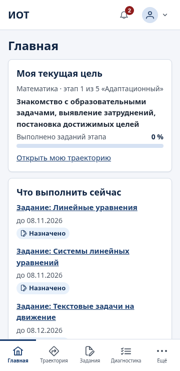
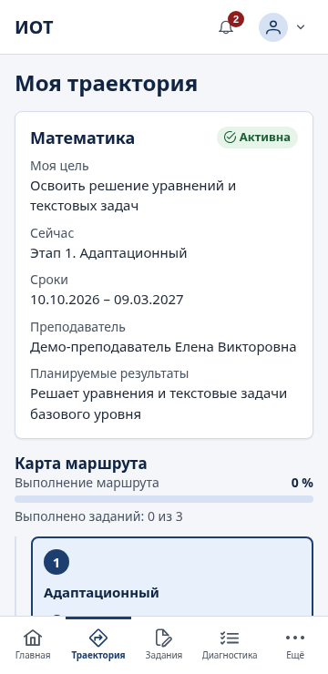
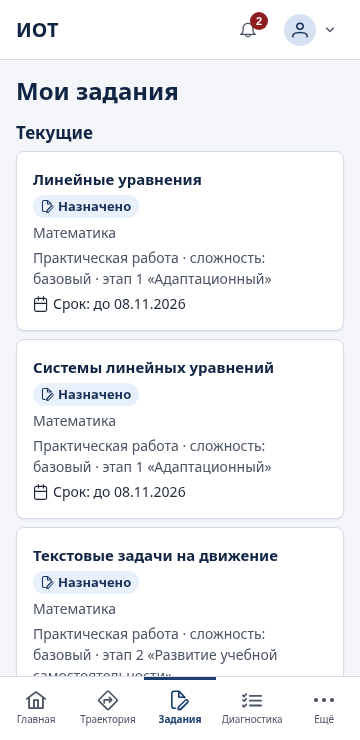
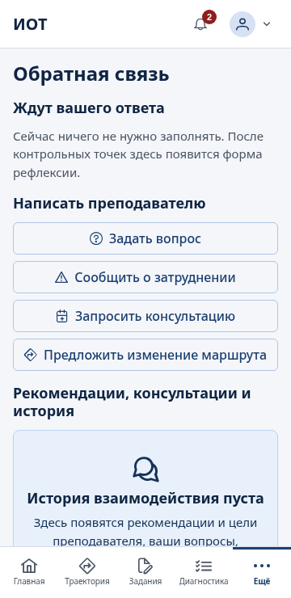

# Руководство студента

В личном кабинете вы видите свою индивидуальную образовательную траекторию (ИОТ), задания, диагностику, достижения и связь с преподавателем. Кабинет удобно открывать со смартфона.

Вы видите только свои данные. Ваши ответы и результаты не видны другим студентам.

## Вход

1. Откройте адрес системы, который сообщил преподаватель или колледж.
2. Введите логин и временный пароль, полученные от преподавателя, и нажмите «Войти».
3. При первом входе система попросит придумать свой пароль: не короче 10 символов, с буквами и цифрами. Введите новый пароль дважды и нажмите «Сменить пароль».

Если забыли пароль, обратитесь к преподавателю: он выдаст новый временный пароль. После нескольких неверных попыток вход временно блокируется — подождите 15 минут.

Сменить пароль позже — значок профиля в правом верхнем углу → «Сменить пароль». Там же «Выйти». Если пользуетесь чужим или общим компьютером, всегда выходите из системы.

## Меню

| Пункт          | Что там                                                  |
| -------------- | -------------------------------------------------------- |
| Главная        | Текущая цель, что сделать сейчас, достижения, где помощь |
| Моя траектория | Ваш маршрут из пяти этапов                               |
| Мои задания    | Задания, сроки, сдача и оценки                           |
| Диагностика    | Методики, которые нужно пройти, и пройденные             |
| Мои достижения | Пройденные этапы, точки, выполненные задания             |
| Обратная связь | Вопросы, консультации, рекомендации преподавателя        |
| Мой профиль    | Код участника, группа, интересы, рекомендации, отзывы    |

На смартфоне первые четыре пункта — в нижней панели, остальные — в меню «Ещё». Колокольчик в шапке показывает число новых уведомлений: новое задание, оценка, ответ преподавателя, изменение маршрута.

## Главная

Главная отвечает на четыре вопроса:

- **«Моя текущая цель»** — цель траектории и текущий этап («этап 1 из 5») по каждой дисциплине;
- **«Что выполнить сейчас»** — задания и диагностика, которые ждут выполнения, с ближайшими сроками;
- **«Чего я достиг»** — сколько пройдено этапов и контрольных точек, выполнено заданий и диагностик;
- **«Где получить помощь»** — ваши преподаватели и кнопки «Задать вопрос» и «Запросить консультацию».

## Моя траектория

Траектория появляется после того, как преподаватель её утвердит. До этого раздел покажет «Траектория пока не назначена».

Вверху — дисциплина и статус маршрута, «Моя цель», «Сейчас» (текущий этап), сроки, преподаватель, планируемые результаты. Ниже — **«Карта маршрута»**: пять этапов с названием, сроками, статусом, процентом выполнения, числом заданий и контрольной точкой. Нажмите на этап, чтобы открыть его цель, содержание, материалы и задания.

Если у вас траектории по нескольким дисциплинам, они показаны по очереди.

**Предложить изменение.** Если хотите что-то изменить в маршруте (другой срок, тема ближе к вашим интересам), нажмите «Предложить изменение», выберите этап или «Маршрут в целом», опишите предложение и нажмите «Отправить». Маршрут меняет только преподаватель; ваши предложения собраны в блоке «Мои предложения», ответ преподавателя придёт в «Обратная связь».

## Мои задания

Задания разделены на «Текущие» и «Выполненные». У каждого — срок и статус:

| Статус                  | Что значит                                       |
| ----------------------- | ------------------------------------------------ |
| Назначено               | Задание выдано, можно начинать                   |
| Выполняется             | Вы приступили к выполнению                       |
| На проверке             | Ответ отправлен, ждёт проверки                   |
| Возвращено на доработку | Преподаватель просит исправить — см. комментарий |
| Выполнено               | Задание принято, балл выставлен                  |

**Выбор задания.** Иногда преподаватель предлагает выбрать задание из нескольких равнозначных («Выберите задание»). Отметьте нужное и нажмите «Подтвердить выбор». Выбор делается один раз.

**Как сдать задание:**

1. Откройте задание. Прочитайте цель, инструкцию, критерии оценивания и ресурсы (файлы можно скачать).
2. Нажмите «Приступить к выполнению».
3. В блоке «Выполнение» дайте ответ так, как требует формат сдачи: «Ответ текстом», «Прикрепить файл» и/или «Ссылка на работу».
4. Нажмите «Отправить на проверку». Появится «Ответ отправлен и ждёт проверки» и номер попытки.

Файлы — PDF, документы Word и OpenDocument, таблицы, презентации, TXT, PNG или JPG, до 20 МБ.

После проверки вы увидите балл (например, «Задание выполнено. Балл: 7 из 8») и комментарий преподавателя. Если задание возвращено на доработку, исправьте ответ и отправьте снова — все попытки сохраняются в блоке «Мои попытки». Ответ, отправленный после срока, принимается, но отмечается как просроченный.

Вопрос по заданию можно задать прямо на странице задания — «Задать вопрос по заданию».

## Диагностика

Диагностика — это опросники о том, как вы учитесь и что вас мотивирует. Правильных и неправильных ответов нет: отвечайте честно, это помогает преподавателю подобрать подходящую поддержку.

Разделы страницы: «Нужно пройти», «Пройдено», «Срок истёк».

1. Откройте методику и прочитайте инструкцию.
2. Нажмите «Начать» и ответьте на вопросы. Ответы сохраняются автоматически («Черновик сохранён») — можно прерваться и продолжить позже, в том числе с другого устройства.
3. Обязательные вопросы отмечены; без ответа на них завершить нельзя.
4. Нажмите «Завершить» и подтвердите. После завершения ответы изменить нельзя.

После завершения вы увидите «Диагностика пройдена» и короткое пояснение по каждой шкале. Подробные баллы видит преподаватель — он обсудит с вами результаты.

## Мои достижения

«Итоги»: пройдено этапов, контрольных точек, выполнено заданий, пройдено диагностик. Ниже — завершённые траектории с итоговой оценкой преподавателя, этапы и контрольные точки, выполненные задания с баллами, пройденная диагностика.

## Обратная связь

**«Ждут вашего ответа»** — то, что просил преподаватель:

- «Заполнить рефлексию» — после пройденной контрольной точки: самооценка, «Что получилось?», «Что было трудно?», «Что будете делать дальше?»;
- «Запрос самооценки» → «Оценить себя».

**«Написать преподавателю»:**

- «Задать вопрос» — по траектории, этапу или в целом;
- «Сообщить о затруднении» — если что-то не получается; преподаватель увидит это сразу;
- «Запросить консультацию» — преподаватель назначит время;
- «Предложить изменение маршрута».

**«Рекомендации, консультации и история»** — рекомендации и краткосрочные цели от преподавателя, назначенные и проведённые консультации с итогами, вся переписка.

## Мой профиль

Код участника, группа, специальность, ваши дисциплины.

- **«Мои интересы»** — напишите, что вам интересно (увлечения, профессиональные планы), и нажмите «Сохранить». Преподаватель учитывает это при составлении маршрута.
- **«Рекомендации по учёбе»** — пояснение по итогам диагностики, утверждённое преподавателем.
- **«Отзывы преподавателей»** — наблюдения, которые преподаватель открыл вам.

## Частые вопросы

**Не вижу траекторию.** Преподаватель ещё не утвердил маршрут. Если ждёте долго — спросите через «Обратная связь».

**Не могу завершить диагностику.** Ответьте на все обязательные вопросы — система подскажет, какие пропущены.

**Ошибся в ответе диагностики после завершения.** Изменить ответы нельзя. Напишите преподавателю.

**Не отправляется файл.** Проверьте формат и размер (до 20 МБ). Исполняемые и переименованные файлы не принимаются.

**Почему у задания нет оценки?** Оно ещё на проверке. Когда преподаватель проверит, придёт уведомление.
