# Руководство преподавателя

Система помогает пройти полный цикл сопровождения студента: диагностика → мотивационный профиль → индивидуальная образовательная траектория (ИОТ) → задания → мониторинг и корректировка → обратная связь → отчёты. Система только **предлагает** — профиль, шаблон маршрута, предупреждения. Решения принимает преподаватель.

Содержание:

1. [Вход и рабочее место](#1-вход-и-рабочее-место)
2. [Главная панель](#2-главная-панель)
3. [Студенты](#3-студенты)
4. [Профиль студента](#4-профиль-студента)
5. [Диагностика (UC-01, UC-06)](#5-диагностика-uc-01-uc-06)
6. [Мотивационные профили (UC-02)](#6-мотивационные-профили-uc-02)
7. [Библиотека материалов и заданий](#7-библиотека-материалов-и-заданий)
8. [Конструктор ИОТ (UC-03)](#8-конструктор-иот-uc-03)
9. [Назначение и проверка заданий (UC-04)](#9-назначение-и-проверка-заданий-uc-04)
10. [Мониторинг и корректировка ИОТ (UC-05)](#10-мониторинг-и-корректировка-иот-uc-05)
11. [Обратная связь и консультации](#11-обратная-связь-и-консультации)
12. [Аналитика](#12-аналитика)
13. [Отчёты](#13-отчёты)
14. [Частые вопросы](#14-частые-вопросы)

## 1. Вход и рабочее место

Учётную запись и временный пароль выдаёт администратор. При первом входе система попросит задать свой пароль (не короче 10 символов, с буквами и цифрами). Сменить пароль позже — меню профиля в правом верхнем углу → «Сменить пароль»; там же «Выйти».

**Шапка** содержит:

- **«Учебная группа»** и **«Дисциплина»** — выбранные значения ограничивают списки во всех разделах (студенты, мониторинг, главная, отчёты). Крестик сбрасывает выбор;
- **колокольчик уведомлений** с числом непрочитанных (новые сообщения студентов, ответы на проверку, просрочки); «Прочитать все» сбрасывает счётчик;
- меню профиля.

**Меню слева:** Главная, Студенты, Диагностика, Мотивационные профили, Индивидуальные траектории, Задания, Мониторинг, Обратная связь, Аналитика, Отчёты; служебные разделы — Дисциплины, Библиотека материалов. На смартфоне меню открывается кнопкой «Открыть меню».

Вы видите только студентов групп, за которыми закреплены администратором, и только по своим дисциплинам. Если нет ни одного закрепления, разделы показывают пояснение — обратитесь к администратору.

**Общие правила интерфейса:**

- «Нет данных» означает, что показатель не рассчитывался (не было диагностики, заданий, оценок). Это не ноль.
- Статус всегда показан текстом и значком, а не только цветом.
- Даты вводятся в формате «дд/мм/гггг».
- Повторное нажатие кнопки отправки формы не создаёт дубликатов.

## 2. Главная панель

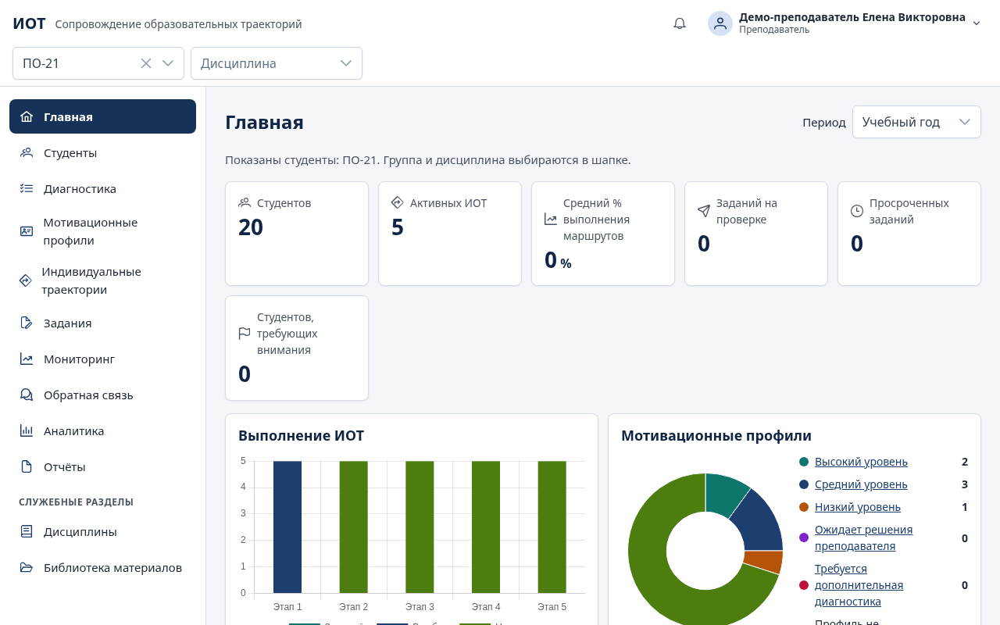

Шесть карточек: «Студентов», «Активных ИОТ», «Средний % выполнения маршрутов», «Заданий на проверке», «Просроченных заданий», «Студентов, требующих внимания». Щелчок по карточке открывает соответствующий отфильтрованный список.

Ниже — диаграммы «Выполнение ИОТ» (сколько маршрутов на каждом этапе) и «Мотивационные профили» (распределение уровней), «Последние задания», «Последняя активность», «Предстоящие контрольные точки и консультации».

Справа вверху — «Период» (например, «Учебный год»). Показатели пересчитываются при смене группы, дисциплины и периода и обновляются автоматически раз в минуту.

## 3. Студенты

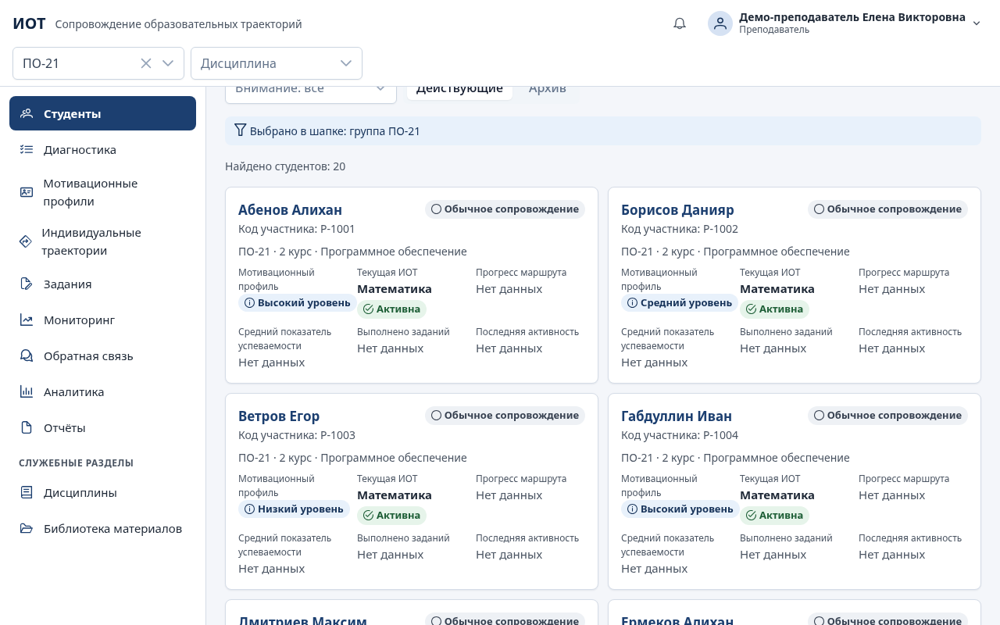

### Список, поиск и фильтры

Поиск — по фамилии, коду участника или группе. Фильтры: мотивационный профиль, статус ИОТ, «Затруднения» (есть нерассмотренные сообщения студента о затруднениях), «Внимание» (студенты со статусом сопровождения «Требует внимания» или «Нужно дополнительное сопровождение», а также с нерассмотренным сообщением о затруднении), «Действующие студенты или архив». «Сбросить фильтры» возвращает полный список.

Карточка студента в списке показывает мотивационный профиль, текущую ИОТ, прогресс маршрута, средний показатель успеваемости, выполненные задания и последнюю активность. Щелчок по ФИО открывает профиль.

### Добавить одного студента

1. «Добавить студента».
2. Фамилия, имя, отчество (если есть), группа; код участника — необязательно (если не указан, система создаёт код вида `S-XXXXXX`).
3. «Добавить». Система покажет логин и **временный пароль один раз** — передайте их студенту лично. При первом входе студент задаст свой пароль.

### Импорт списка из файла

1. «Импорт» → «Скачать шаблон» — образец файла.
2. Заполните файл: CSV (UTF-8 или Windows-1251; разделитель «;», «,» или табуляция) или XLSX. Колонки: «Фамилия», «Имя», «Отчество», «Группа», «Код участника», «Логин»; обязательны «Фамилия», «Имя», «Группа». Группа должна уже существовать в системе.
3. Выберите файл. Система покажет предпросмотр: корректные строки и строки с ошибками с объяснением по каждой.
4. «Импортировать: N» — загружаются только корректные строки.
5. «Скачать список паролей (CSV)» — логины и временные пароли новых студентов. Файл скачивается только сейчас: храните его как конфиденциальный и удалите после раздачи паролей.

### Карточка студента: перевод, архив, пароль

В профиле студента — «Управление карточкой»:

- **«Изменить ФИО»**;
- **«Перевести»** — выберите новую группу и укажите причину. История групп сохраняется;
- **«Новый пароль»** → «Выдать пароль» — новый временный пароль, если студент забыл свой;
- **«В архив»** с причиной — студент скрывается из списков, вход для него закрывается, все данные сохраняются. «Вернуть из архива» восстанавливает доступ.

## 4. Профиль студента

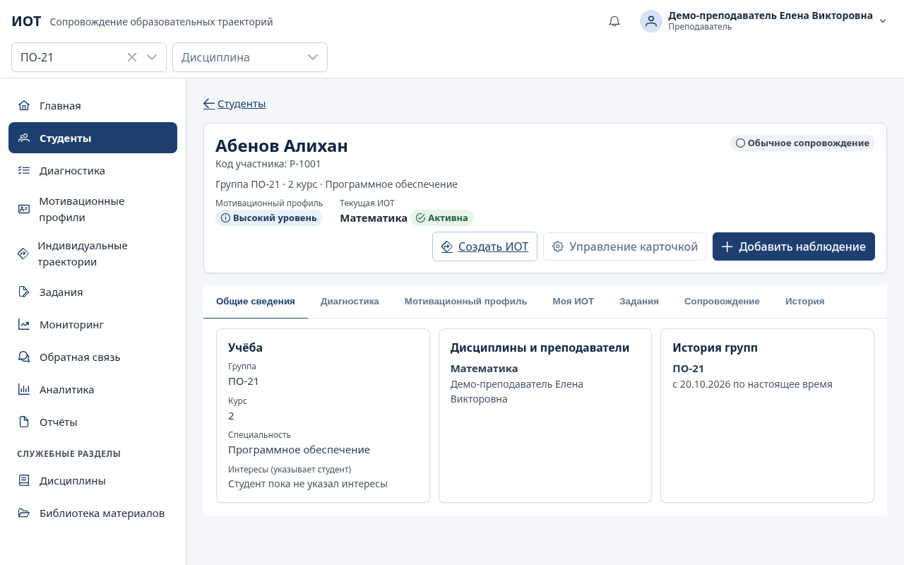

Профиль объединяет всё о студенте на семи вкладках:

| Вкладка               | Содержание                                                                                           |
| --------------------- | ---------------------------------------------------------------------------------------------------- |
| Общие сведения        | Группа, курс, специальность, интересы (указывает студент), дисциплины и преподаватели, история групп |
| Диагностика           | Все прохождения методик, результаты по шкалам, динамика и сравнение замеров                          |
| Мотивационный профиль | Текущий профиль, его основания, решение преподавателя, история                                       |
| Моя ИОТ               | Карта действующей ИОТ и все маршруты студента                                                        |
| Задания               | Назначенные задания, их статусы и оценки                                                             |
| Сопровождение         | Педагогические наблюдения, сообщения, консультации, рефлексия, история взаимодействия                |
| История               | Значимые события с датой и автором: диагностика, профиль, ИОТ, перевод                               |

### Педагогические наблюдения

Кнопка «Добавить наблюдение» в верхней карточке профиля: дата наблюдения, дисциплина (необязательно), текст и **«Кому видно»**:

- «Видно только преподавателям» — служебная заметка. Студент её не получает ни на экране, ни через API, ни в отчётах;
- «Видно студенту» — студент увидит отзыв в разделе «Мой профиль».

Наблюдения показаны на вкладке «Сопровождение» с датой, автором и пометкой видимости; изменить своё наблюдение можно кнопкой «Изменить».

## 5. Диагностика (UC-01, UC-06)

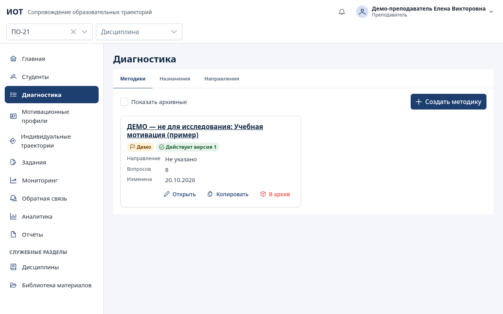

Раздел содержит вкладки «Методики», «Назначения», «Направления».

### Методики

Список методик с действующей версией и черновиком. Демо-методика помечена «Демо» и словами «ДЕМО — не для исследования» в названии: она показывает работу системы и не используется для исследования и педагогических решений.

Создание и изменение методик (паспорт, вопросы, шкалы, ключи, правила интерпретации, версии) описаны в отдельной инструкции — [methodologies.md](methodologies.md). Опубликованная версия методики не изменяется; изменение ключей или шкал делается новой версией, а прежние результаты не пересчитываются.

### Назначить диагностику

1. «Назначения» → «Назначить диагностику».
2. Выберите методику, «Замер» («Первичный», «Промежуточный» или «Повторный») и версию методики.
3. «Кому назначить»: «Всей группе» или «Одному студенту» (выберите группу, затем студента).
4. Период: «Начало» и «Окончание (включительно)».
5. «Назначить». Студенты получат уведомление; в окне «Прохождения диагностики» видно, кто прошёл.

Отменить назначение — «Прохождения» → «Отменить назначение»: незавершённые прохождения закрываются, завершённые сохраняются.

### Как студент проходит диагностику

Студент открывает «Диагностика» в кабинете, читает инструкцию, нажимает «Начать» и отвечает на вопросы. Ответы сохраняются как черновик автоматически — можно прерваться и продолжить позже. Без ответа на обязательные вопросы завершить нельзя. После «Завершить» система рассчитывает баллы по шкалам и показывает студенту понятную интерпретацию.

### Ввод бумажного бланка

Если студент проходил методику на бумаге: «Назначения» → нужное назначение → «Прохождения» → «Ввести бланк» у студента → внесите ответы → «Сохранить результаты». Результат рассчитывается так же, как при онлайн-прохождении, и помечается способом «Бумажный бланк». Повторный ввод по тому же прохождению запрещён.

### Результаты и исправление ошибок

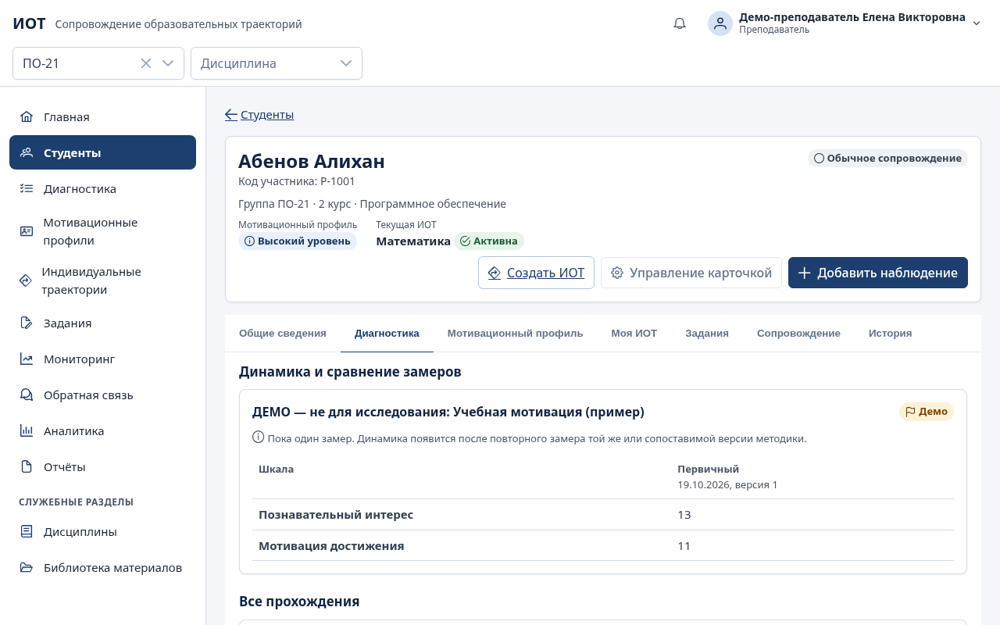

Профиль студента → «Диагностика»: для каждого прохождения указаны методика, версия методики, замер, период, дата прохождения, способ и время прохождения, баллы и уровни по шкалам.

Завершённые ответы изменить нельзя. Если при вводе бланка допущена ошибка: «Ответы и ревизии» → «Исправить ошибочный ввод» → внесите верные ответы, укажите причину → «Сохранить исправление». Исходные ответы сохраняются, исправление становится новой ревизией («Действующая»; прежняя — «Заменена исправлением») и записывается в журнал аудита.

### Повторный замер и сравнение (UC-06)

1. Назначьте ту же методику с замером «Повторный» (или «Промежуточный»).
2. После прохождения откройте профиль → «Диагностика» → «Динамика и сравнение замеров».
3. Таблица показывает баллы по замерам и изменение (например, «2 → 13 (+11)»), ниже — график динамики. Пропущенные значения обозначены «Нет данных».

Замеры сравниваются по одной версии методики. Разные версии объединяются, только если исследователь утвердил их сопоставимость.

## 6. Мотивационные профили (UC-02)

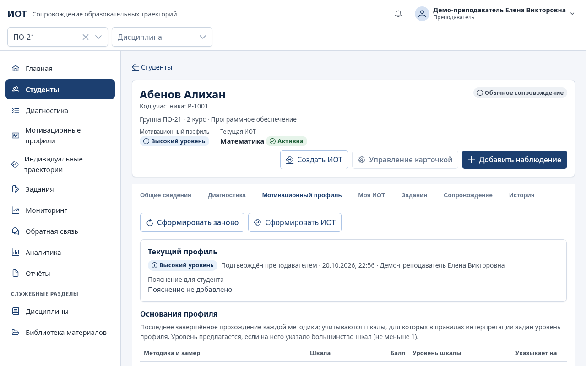

### Сформировать профиль

1. Профиль студента → «Мотивационный профиль» → «Сформировать предварительный профиль».
2. Система применяет правила интерпретации методики и показывает: «Система предлагает: Высокий / Средний / Низкий уровень» и таблицу «Показатели, повлиявшие на профиль» (шкалы, баллы, уровни).
3. Если данных недостаточно (нет завершённой диагностики или шкалы указывают на разные уровни), профиль получает статус **«Требуется дополнительная диагностика»** — уровень не присваивается.

### Подтвердить или скорректировать

«Подтвердить или скорректировать» → в окне «Решение по мотивационному профилю»:

- согласны с предложением — «Подтвердить» (статус «Подтверждён преподавателем»);
- не согласны — выберите другой уровень, **укажите причину** и нажмите «Скорректировать» (статус «Скорректирован преподавателем»; причина и исходное предложение сохраняются).

После решения появляется кнопка **«Сформировать ИОТ»** — переход в конструктор маршрута с шаблоном под уровень профиля. «История профиля» показывает все предложения и решения с автором, датой и причиной. «Сформировать заново» нужно после новой диагностики.

Студент видит только утверждённое понятное пояснение в «Мой профиль» — без уровня и оснований.

### Раздел «Мотивационные профили»

Три карточки уровней со стратегиями сопровождения (тексты задаёт администратор), распределение студентов по уровням и список «Требуют внимания» (профиль не формировался или нужна дополнительная диагностика). Щелчок по уровню открывает отфильтрованный список студентов.

Профиль служит для организации поддержки и **не ограничивает** сложность заданий: студенту с любым профилем можно назначить задание любого уровня.

## 7. Библиотека материалов и заданий

### Материалы

«Библиотека материалов» → «Добавить материал»: название, дисциплина (или «Общий материал»), тема, описание и содержание одного из видов:

- **файл** — PDF, документы Word и OpenDocument, таблицы, презентации, TXT, PNG или JPG, до 20 МБ. Тип проверяется по содержимому файла: переименованный исполняемый файл будет отклонён;
- **ссылка** — адрес, начинающийся с `https://`;
- **текст**.

Поиск — по названию, описанию или теме; фильтры по дисциплине, теме и виду. «В архив» с причиной скрывает материал из поиска, «Вернуть из архива» — возвращает.

### Задания

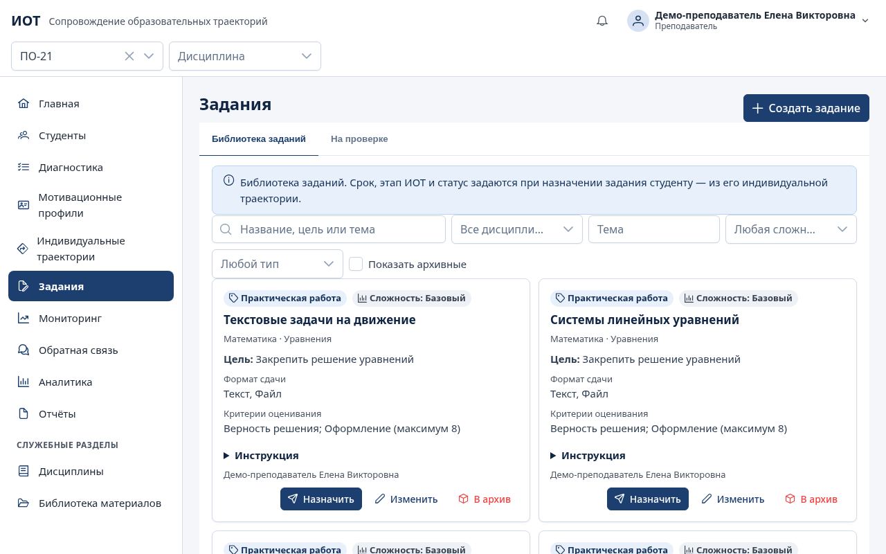

«Задания» → вкладка «Библиотека заданий» → «Создать задание»:

- название, дисциплина, тема (если есть), образовательная цель, инструкция;
- тип (из списка или «Добавить свой тип», например «эссе») и уровень сложности: «Базовый», «Средний», «Повышенный»;
- формат сдачи: текст, файл, ссылка (можно несколько);
- критерии оценивания: формулировка критерия, «Макс. балл» и что проверяется — «Добавить критерий»;
- ресурсы: «Прикрепить файл», «Добавить ссылку».

Поиск — по названию, цели или теме; фильтры по дисциплине, теме, сложности и типу. Задание можно «Изменить», отправить «В архив», «Назначить» студентам (см. раздел 9).

## 8. Конструктор ИОТ (UC-03)

ИОТ создаётся по пятиэтапной модели: 1) Адаптационный; 2) Развитие учебной самостоятельности; 3) Практико-ориентированная деятельность; 4) Проектная деятельность; 5) Профессиональное развитие. Продолжительность, содержание и результаты этапов преподаватель адаптирует.

### Создание маршрута

Начать можно двумя способами: кнопкой «Сформировать ИОТ» на вкладке «Мотивационный профиль» или в разделе «Индивидуальные траектории».

1. **① Дисциплина и шаблон.** Выберите студента и дисциплину. Система предложит шаблон по утверждённому профилю (метка «Предложено по профилю»); без профиля — стандартный пятиэтапный шаблон. Можно выбрать любой шаблон или начать с нуля. «Создать черновик и продолжить».
2. **② Цели и сроки маршрута.** «Образовательные цели», «Планируемые результаты», «Дата начала», «Планируемая дата завершения».
3. **③ Этапы маршрута.** Для каждого этапа — название, «Цель этапа», «Содержание», «Планируемые результаты этапа»; «Добавить этап», перемещение и удаление этапов.
4. **④ Задания и материалы этапов.** «Добавить задания» и «Добавить материалы» из библиотеки дисциплины для каждого этапа.
5. **⑤ Сроки и контрольные точки.** «Начало этапа» и «Окончание этапа»; «Добавить контрольную точку» — название и дата.
6. **⑥ Формы поддержки и сопровождения.** «Способы сопровождения»: консультации, обратная связь, формы помощи студенту.
7. **⑦ Предварительный просмотр.** Паспорт и карта пяти этапов в том виде, в каком их увидит студент.

Кнопки внизу: «Назад», «Далее», «Сохранить черновик». Черновик сохраняется на каждом шаге — можно вернуться к нему позже из раздела «Индивидуальные траектории».

### Утверждение

- **«Утвердить и назначить»** → подтвердите в окне. Система проверит полноту: если не заполнены обязательные поля, они будут названы. После утверждения ИОТ получает статус «Активна» и версию 1, задания этапов назначаются студенту, студент получает уведомление и видит маршрут в кабинете.
- **«Отправить на согласование»** — если маршрут должен утвердить другой преподаватель с правом утверждения. Статус «На утверждении»; согласующий нажимает «Утвердить и назначить» или «Вернуть на доработку» с причиной.

Утверждает маршрут только преподаватель с правом «Утверждение ИОТ»; студент утвердить или изменить маршрут не может.

У студента может быть несколько ИОТ по **разным** дисциплинам; по одной дисциплине — одна действующая. Студенту из **контрольной группы** исследования (в статусе «Подготовка» или «Проводится») ИОТ создать и утвердить нельзя: система откажет с пояснением.

### Статусы ИОТ

| Статус                | Значение                                                 |
| --------------------- | -------------------------------------------------------- |
| Черновик              | Маршрут составляется, студент его не видит               |
| На утверждении        | Отправлен на согласование                                |
| Активна               | Утверждён, опубликован в кабинете студента               |
| Требует корректировки | Отмечен преподавателем или по итогам мониторинга         |
| Завершена             | Маршрут закрыт с итоговой оценкой достижения целей       |
| Архивирована          | Маршрут перенесён в архив, доступен только для просмотра |

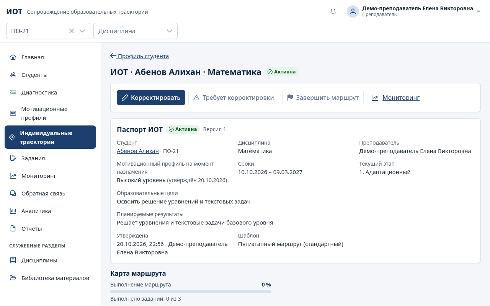

## 9. Назначение и проверка заданий (UC-04)

### Назначить задание

Задания этапов ИОТ назначаются автоматически при утверждении маршрута. Дополнительно задание можно назначить вручную: «Задания» → «Библиотека заданий» → «Назначить».

1. «Кому»: «Всей группе» или «Отдельным студентам».
2. «Срок сдачи (необязательно)».
3. «Дать студенту выбор из равнозначных заданий» — отметьте, добавьте альтернативные задания той же дисциплины, задайте «Название набора» и «Сколько заданий выбрать». Студент выберет сам; выбор делается один раз.
4. «Назначить». Если у студента уже есть это задание, повтор пропускается с пояснением.

### Проверить ответ

1. «Задания» → вкладка «На проверке» (или карточка «Заданий на проверке» на главной). Ответы, отправленные после срока, помечены «Отправлено после срока».
2. Откройте ответ: видны сведения о задании, инструкция и критерии, ответы студента (текст, файлы, ссылки) и история попыток.
3. В блоке «Решение» выставьте баллы по каждому критерию, добавьте пояснения и общий комментарий.
4. «Принять» — задание выполнено, балл записан в успеваемость, прогресс этапа и ИОТ пересчитан. «Вернуть на доработку» — **комментарий обязателен**; студент исправит и отправит новую попытку, прежние сохранятся.

Когда все задания этапа приняты, этап завершается и текущим становится следующий.

## 10. Мониторинг и корректировка ИОТ (UC-05)

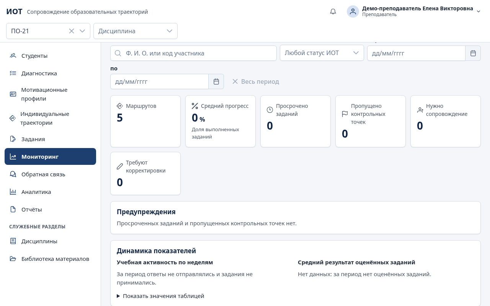

### Показатели

«Мониторинг» показывает сводку («Маршрутов», «Средний прогресс», «Просрочено заданий», «Пропущено контрольных точек», «Нужно сопровождение», «Требуют корректировки»), предупреждения, динамику и список маршрутов студентов с прогрессом. Фильтры — поиск по студенту, статус ИОТ, период; группа и дисциплина — в шапке.

Предупреждения появляются автоматически при просрочке задания или пропуске контрольной точки; вы также получаете уведомление (один раз на событие).

«Подробнее и корректировка» у студента открывает детали: выполнение этапов и контрольных точек, учебную активность и успешность, оценённые задания, графики динамики и отдельный блок «Психолого-педагогическая диагностика». Учебная активность и диагностика учитываются раздельно: то, что студент давно не входил в систему, не снижает его диагностические показатели.

### Действия

- **Контрольные точки:** «Отметить пройденной» или «Отметить пропущенной». После пройденной точки студенту предлагается заполнить рефлексию.
- **«Статус сопровождения»:** «Обычное сопровождение», «Требует внимания», «Нужно дополнительное сопровождение». Отметка видна в мониторинге и в фильтре «Внимание» раздела «Студенты».
- **«Отметить «Требует корректировки»»** — статус ИОТ меняется, маршрут попадает в фильтр.
- **«Назначить консультацию».**

### Корректировка маршрута

1. Страница ИОТ → «Корректировать». Открывается конструктор с текущим маршрутом.
2. Внесите изменения: цели, сроки, этапы, задания, контрольные точки, формы поддержки.
3. «Подтвердить новую версию» → **укажите причину корректировки** (без неё сохранить нельзя).
4. Система сообщит «Утверждена версия N: прежняя версия сохранена», студент получит уведомление.

«История версий» на странице ИОТ: у каждой версии — дата, автор, причина и список изменений; «Открыть версию N» показывает прежний маршрут без изменений. «Отменить корректировку» закрывает конструктор без новой версии.

### Завершение и архив

«Завершить маршрут» → итоговая оценка достижения целей (студент её увидит) → «Завершить». Статус «Завершена». После этого маршрут можно «Перенести ИОТ в архив».

## 11. Обратная связь и консультации

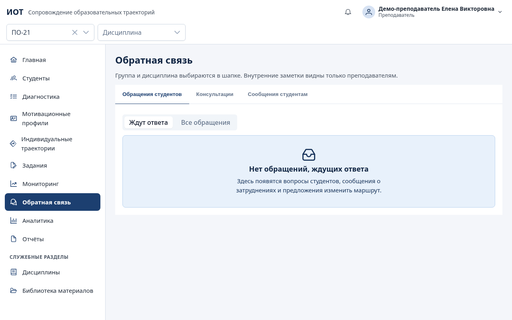

Раздел состоит из трёх блоков:

- **«Обращения студентов»** — вопросы, сообщения о затруднениях, предложения изменить маршрут, запросы консультаций. «Ответить», затем «Отметить рассмотренным». Пока сообщение о затруднении не рассмотрено, студент попадает в фильтр «Затруднения».
- **«Консультации»** — «Назначить консультацию»: студент, тема, привязка к ИОТ (или «Без привязки к ИОТ»), дата, время «чч:мм». Запрошенную студентом консультацию — «Назначить время»; после встречи — «Отметить проведённой»: дата и время проведения, «Итог для студента» и «Внутренняя заметка» (её студент не видит); «Перенести», «Отменить».
- **«Сообщения студентам»** — «Новое сообщение»: студент, «Вид сообщения» (рекомендация, комментарий, краткосрочная цель, запрос самооценки), привязка к ИОТ и этапу (или «Студент в целом», «Маршрут в целом»), срок для цели или ответа и **«Кому видно»**:
  - «Студенту — он получит уведомление»;
  - «Только преподавателям — внутренняя заметка» — студент её не видит.

Вопросы студента по конкретному заданию и ваши комментарии к нему («Комментировать») — на странице проверки задания. Вкладка «Сопровождение» профиля студента собирает все сообщения, консультации, рефлексию и самооценку в «История взаимодействия».

## 12. Аналитика

«Аналитика» → вкладка «Показатели»: выполнение ИОТ, академическая успешность и активность, распределение мотивационных профилей, результативность заданий, динамика мотивации до и после сопровождения. Для числовых показателей — описательные статистики: n, среднее, медиана, стандартное отклонение, минимум и максимум, квартили; группы сравниваются в одной таблице. Пропуски не превращаются в нули; если значение одно, отклонение не рассчитывается.

Исследования (экспериментальная и контрольная группы, обезличенный экспорт) ведёт исследователь — см. [researcher.md](researcher.md).

## 13. Отчёты

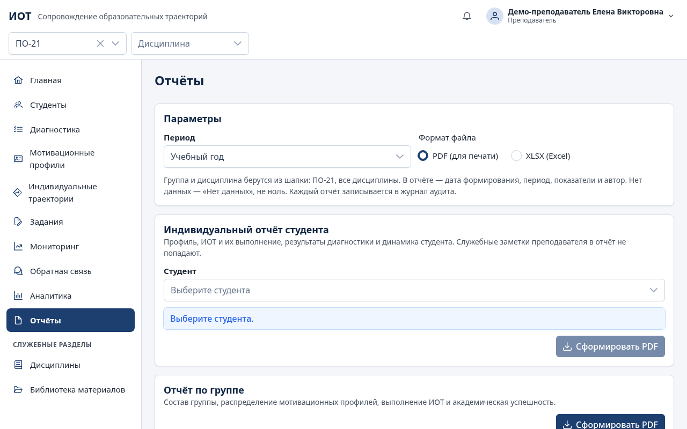

1. «Отчёты» → выберите вид:
   - **Индивидуальный отчёт студента** — профиль, ИОТ и их выполнение, результаты диагностики и динамика. Служебные заметки в отчёт не попадают;
   - **Отчёт по группе** — состав, распределение профилей, выполнение ИОТ, успешность;
   - **Отчёт по реализации ИОТ** — статус, прогресс, этапы, контрольные точки и оценки по каждой ИОТ, предупреждения;
   - **Отчёт по диагностике** — прохождения методики, статистики шкал по замерам, изменение до и после сопровождения.
2. Укажите параметры: группу (в шапке), студента (для индивидуального), период.
3. «Сформировать PDF» или «Сформировать XLSX».

В каждом отчёте указаны дата формирования, период, показатели и автор. Формирование отчёта записывается в журнал аудита.

## 14. Частые вопросы

**Почему вместо числа написано «Нет данных»?** Показатель не рассчитывался: не было диагностики, заданий или оценок. Система не подставляет нули.

**Можно ли изменить ответы студента после завершения диагностики?** Нет. Если ошибка допущена при вводе бланка — «Исправить ошибочный ввод» с причиной; исходные ответы сохраняются.

**Студент не видит маршрут.** Маршрут виден студенту только после утверждения (статус «Активна»).

**Нужно изменить утверждённый маршрут.** Только через «Корректировать» с причиной — создаётся новая версия, прежняя сохраняется.

**Почему нельзя создать ИОТ студенту?** Студент входит в контрольную группу исследования, либо по этой дисциплине у него уже есть действующая ИОТ.

**Студент забыл пароль.** Профиль студента → «Управление карточкой» → «Новый пароль» → «Выдать пароль».
